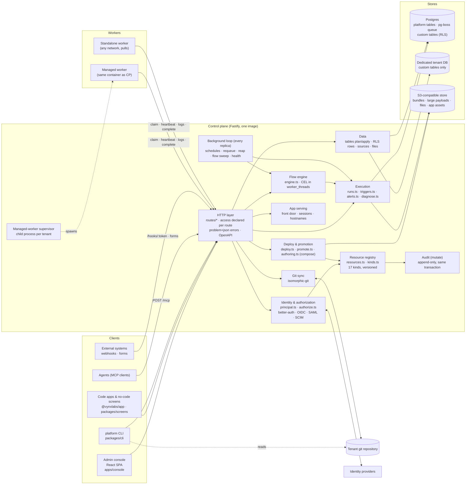
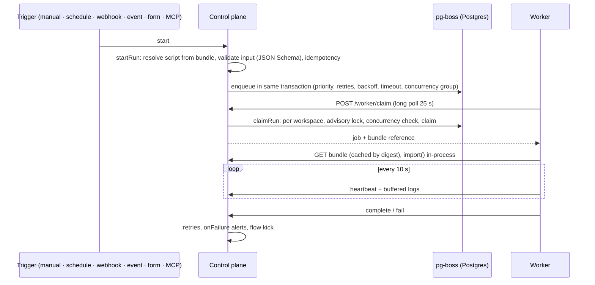

# 1. Product architecture assessment

What the platform is made of today, how the parts talk to each other, what is strong, and what will limit it. Evidence labels are explained in the [README](README.md).

## The system in one paragraph

A single Node service, the **control plane**, holds the API, identity, permissions, the resource registry, the queue, the scheduler, the event bus, the flow engine, the run log, the audit log, the admin console and the serving of apps. Postgres is the only stateful dependency besides an S3-compatible store. **Workers** pull jobs over HTTP and run a workspace's bundle. Everything a tenant builds is a **resource**, described by a manifest and shipped in an immutable **bundle**. Bundles are produced either by the CLI from a git repository or by the control plane from console drafts. **Verified**: `docs/master-spec.md` "System architecture", `apps/control-plane/src/main.ts`, `apps/control-plane/src/app.ts:148-193`.

## Architecture diagram

## Stack

| Layer | Choice | Where |
| --- | --- | --- |
| Language and runtime | TypeScript, Node 24, pnpm 9 monorepo, Biome, `tsc -b` | `package.json` |
| HTTP | Fastify 5, TypeBox validation, `@fastify/rate-limit`, `@fastify/swagger` (OpenAPI 3.1 at `/api/v1/openapi.json`) | `apps/control-plane/src/app.ts` |
| Database | Postgres via Kysely and `pg`. No ORM. Hand-written schema types | `packages/db/src/schema.ts` |
| Queue | pg-boss 12 wrapped by `JobQueue`. It can enqueue inside the caller's transaction | `packages/db/src/queue.ts` |
| Migrations | 45 forward-only SQL files, checksum-locked, serialized across replicas by an advisory lock | `packages/db/migrations`, `packages/db/src/migrate.ts:95` |
| Identity | better-auth for member sessions, `openid-client`, `@node-saml/node-saml`, own SCIM 2.0 | `kernel/auth.ts`, `kernel/sso/*` |
| Expressions | CEL (`@marcbachmann/cel-js`), evaluated in `worker_threads` with size, depth, time and memory limits | `kernel/flows/expressions.ts` |
| Git | isomorphic-git; the server pushes and pulls over HTTPS tokens | `kernel/git.ts` |
| Build | esbuild for bundles (CLI and `packages/compose`), Vite for code apps | `packages/cli/src/build.ts`, `packages/compose` |
| Console | React, Vite, Base UI, Tailwind, Monaco, React Flow, Vega-Lite | `apps/console`, `packages/ui` |
| Agents | `@modelcontextprotocol/sdk`, streamable HTTP, no sessions | `routes/mcp.ts` |

## Subsystems

### Resource model

All 17 kinds live in one `resource` table with a `resource_version` history. Kinds are registered with JSON Schemas in `packages/manifest/src/kinds.ts` and published to `schemas/kinds/*.v1.schema.json`. Scripts, flows, triggers, connections, tables, apps, roles and bindings are not separate tables. **Verified.**

This is the platform's best structural decision. Deploy, promotion, clone, export, git sync and console drafts all move the same objects through one path (`putResource` with kind hooks). Adding a capability usually means adding a kind or extending a kind's schema, not a subsystem.

### Bundles, deploy and promotion

- `platform build` loads `src/index.ts` with esbuild, turns each `define*` into a manifest, merges YAML resources under `platform/`, adds the core nodes a flow uses, validates everything and writes a digest-signed bundle. **Verified**: `packages/cli/src/build.ts`.
- The control plane composes the same kind of bundle from console drafts, using the same `packages/compose`. **Verified**: `kernel/authoring.ts`.
- `deployBundle` (`kernel/execution/deploy.ts`) runs in one transaction. It locks the workspace, checks core-version compatibility, checks for missing bindings, upserts resources through their kind hooks, applies table changes, writes an audit entry and sets `active_bundle_id`. Production refuses a missing binding (`409 bindings_missing`); dev only warns. **Verified.**
- Promotion re-activates the same bundle in the linked workspace without rebuilding. **Verified**: `kernel/execution/promote.ts`.

### Execution

- `startRun` (`kernel/execution/runs.ts:136-247`) validates input, deduplicates by idempotency key, stores large payloads in S3 (over 256 KB), and enqueues inside the caller's transaction. **Verified.**
- `claimRun` (`runs.ts:255-334`) walks every active workspace of the tenant. For each one it opens a transaction, takes an advisory lock, counts running runs against `workspace.concurrency_limit`, then claims. The worker route calls it every 500 ms for up to 25 s per waiting slot (`routes/worker.ts:144-180`). **Verified.**
- The worker writes the bundle code to a file and `import()`s it **inside its own process**. Up to 4 runs share that process. **Verified**: `packages/worker/src/worker.ts:202-221`.
- A timeout aborts a signal and races the script's promise. Code that ignores the signal keeps running; only the attempt is reported over. **Verified**: `worker.ts:426-430`.
- Lost runs are requeued after 30 s without a heartbeat. The background loop runs every 2 s on every replica, and schedules use `FOR UPDATE SKIP LOCKED`. **Verified**: `kernel/execution/background.ts`.

### Flows

- A definition is `{nodes, edges, layout}` (`packages/manifest/src/flow.ts`). The node types are trigger, script, set, branch, join, delay, fail, foreach (up to 1,000 items, with concurrency and `continueOnError`), approval (with approver groups or roles), subflow (including one chosen by data) and respond. **Verified.**
- `advance()` in `kernel/flows/engine.ts` runs in one transaction under a per-run advisory lock, settles finished steps, starts ready ones and repeats. State lives in `flow_run` and `step_run`, so a flow survives restarts. A 2 s sweeper picks up anything stalled. **Verified.**
- Each flow run is pinned to the bundle that started it. **Verified**: `runs.ts:154-167`.
- A step has no retry setting of its own; it inherits the script's `retries`. **Verified.**

### Triggers and events

All in `kernel/execution/triggers.ts` and `kernel/flows/events.ts`. **Verified.**

- **Schedules:** cron with a timezone. After an outage a schedule fires once, not once per missed slot. A schedule can poll a trigger source that keeps a cursor.
- **Webhooks** at `POST /api/v1/hooks/:token`:
  - rate limited to 120 per minute
  - optional HMAC
  - an `idempotency-key` header
  - can respond synchronously for up to 25 s
  - refusals are kept
- **Events:** stored, then subscribers start in the same transaction. Chains stop at depth 10, and a CEL filter can be set per subscription.
- **Pausing:** a whole workspace, or a single trigger.

### Data

- Custom tables are planned by diffing the catalog against the manifest (`kernel/data/plan.ts`) and applied by `apply.ts`. Renames keep data. Removed columns are retired, and only an explicit purge drops them. **Verified.**
- Row access runs as a non-owner role with Postgres RLS. Principal and groups are set per transaction (`kernel/data/rows.ts:186`). **Verified.**
- A dedicated database holds only a tenant's custom tables. The router returns the shared platform database for everything else (`packages/db/src/router.ts`, `datastore.ts`). **Verified.**
- External data sources are Postgres only, with a 15 s statement timeout and a periodic health check. **Verified.**

### Identity and authorization

- **Principals:** members (session or `vxk_` API key), service accounts, end users and app sessions, anonymous, workers (`vxw_`), SCIM tokens. **Verified**: `kernel/principal.ts`.
- **Declared access:** every route must declare `config.access`, and a route without one throws (`kernel/http.ts:168`). Today there are 81 workspace-scoped, 61 tenant-scoped, 21 instance-scoped, 34 custom, 23 public and 12 signed-in routes. **Verified.**
- **Permission check:** one `check()` over `kind:verb` permissions with wildcards and five binding scopes. A caller with no standing in a tenant gets 404 rather than 403. Operators need a time-boxed, audited access grant. **Verified**: `kernel/authorize.ts`.
- **Audit enforcement:** a write that commits without an audit entry fails (`kernel/audit.ts:77-95`), and a non-GET success without `mutate` throws (`http.ts:227-243`). **Verified.**

### Console

- A hand-rolled `pushState` router (`apps/console/src/router.tsx`) with routes spread through `App.tsx` and `screens/Tenant.tsx`. There is no central route table and no 404 screen. **Verified.**
- Data is fetched by `useLoad(path)` (`apps/console/src/api.ts:68`): `useState` and `useEffect` with a reload counter. There is no cache, no request deduplication and no shared invalidation. **Verified.**
- Live state comes from interval polling only. There is no SSE or WebSocket in the console or the control plane. **Verified** (grep finds no `EventSource` or `WebSocket`).
- About 21,700 lines across `screens/*.tsx`. The largest are `Interfaces.tsx` (1,998), `FlowEditor.tsx` (1,343) and `Execution.tsx` (1,286). **Verified.**

### Observability

- **Logs:** pino with a request ID echoed back. Managed workers' output is relayed into the control-plane log. **Verified.**
- **Metrics:** `GET /api/v1/metrics` exposes four Prometheus gauges (runs queued, runs running, oldest queued age, recent workers). There are no latency histograms, error counters or flow metrics. **Verified**: `routes/execution.ts:2124-2170`.
- **Tracing:** none. **Verified.**
- **Health and diagnosis:** `/healthz`, `/readyz` (database and S3), scheduled connection and data source checks, refused requests kept, and `runs/:id/insight` with a suggested next step for known failure shapes (`kernel/execution/diagnose.ts`). **Verified.**
- **Alerts:** on a final failure, `sendAlerts` starts the script's `onFailure` handler, posts to a notification connection, or both. The workspace default applies when the script names none. **Verified**: `kernel/execution/alerts.ts`.

### Testing

| Package | Test files | Approx. tests |
| --- | --- | --- |
| `apps/control-plane` (integration, real Postgres) | 32 | 488 |
| `apps/console` | 26 | 116 |
| `packages/ui` | 9 | 72 |
| `packages/cli`, `manifest`, `db`, `screens`, `app`, `compose`, `sdk` | 19 | 126 |
| `packages/worker` | **0** | covered only through 8 control-plane suites that run it in-process |
| `packages/nodes` | **0** | |
| `e2e/` (Playwright against the image) | 2 specs | phase 7 exit criterion and redesign widths and themes |

CI in `.github/workflows/ci.yml` runs lint, typecheck and tests on Postgres 16 and 18, schema and migration-lock checks, a license check, an image smoke boot and e2e. **Verified** that it is defined. The phase docs say it **has never run on GitHub**.

## Technical strengths

1. **One resource model and one deploy path.** Drafts, CLI deploys, promotion, clone, export and git sync all reuse `putResource`. New capabilities compose instead of multiplying.
2. **Audit you cannot bypass.** Writes fail closed without an audit entry, and the audit table is append-only through triggers.
3. **Authorization that fails closed.** Undeclared routes throw, there is one `check()`, and the 404-not-403 rule prevents tenant probing.
4. **Durable, pinned flows.** Flow state is saved after every step, runs are pinned to a bundle, and the engine is small enough to reason about (about 1,100 lines).
5. **Schema-first execution.** Zod becomes JSON Schema in the manifest, and one schema drives run-time validation, console forms and MCP tool definitions.
6. **Data changes that never lose data.** Retire-not-drop, rename tracking, explicit purge, and RLS for end users.
7. **Pull workers and portability.** A worker can live inside a client's network, and a tenant can move between instances with its keys.
8. **Consistent error shape.** RFC 9457 problem documents with a stable `code` and `requestId` everywhere, including better-auth's errors.
9. **Disciplined code base.** No TODO, FIXME or HACK markers, locked migrations, generated schemas checked in CI, and a license allowlist.

## Limitations that matter

Ordered by how much they constrain the product. Each feeds a roadmap item in [07-roadmap.md](07-roadmap.md).

| # | Limitation | Evidence | Consequence |
| --- | --- | --- | --- |
| A1 | **Timeouts do not stop code.** A script that ignores `ctx.signal` keeps running after its attempt is reported over, sharing the process with up to 3 other runs. There is no CPU or memory cap. | **Verified** `packages/worker/src/worker.ts:426-430` | A runaway loop or leak degrades every run on that worker. A "timed out" run may still be writing to an external system. |
| A2 | **Managed workers run beside the control plane, as the same user, and scripts run beside the worker's credential.** The environment is stripped (`supervisor.ts:64-76`), but the child shares the container and uid. Within any worker, script code shares a process with `PLATFORM_WORKER_TOKEN`, a tenant-scoped credential that can claim any of the tenant's jobs (`worker.ts:153-158`). | **Verified** spawn, env and in-process `import()`. **Inferred** that tenant code can read `/proc/<ppid>/environ` (`MASTER_KEY`, `DATABASE_URL`) and the control plane's files | The trust model accepts this today ("code is trusted"). It conflicts with "workers are kept separate per tenant so isolation can be tightened later". It becomes a real exposure as soon as a client's own developers get `code:write`, which phase 7 enables. |
| A3 | **Nothing is ever pruned.** There is no retention for `run`, `run_log`, `event`, `step_run`, `webhook_refusal` or S3 payloads. `audit_entry` cannot be deleted at all because of its triggers. The spec requires per-tenant retention and leaves the default as an open question. | **Verified** grep finds no prune paths; `docs/master-spec.md:546-551, 749` | The database grows without bound on the shared instance. Tenant deletion cannot remove audit history. |
| A4 | **Log lines are dropped silently** when a flush fails. | **Verified** `worker.ts:232` `.catch(() => {})` | A run can look clean while its evidence is missing. That is the worst case for the "debug a failed task" journey. |
| A5 | **No push channel.** Live views poll at 1.5–5 s (`Runs.tsx:102`, `Execution.tsx:309`, `Flows.tsx:570`). The overview, approvals, triggers and workers never refresh, and the shell's counts refresh only on navigation. | **Verified** | Stale operational views, extra load, and no path to notifications or a live log tail at scale. |
| A6 | **Claim loop cost grows with workspaces times slots.** Each waiting slot opens one transaction per workspace every 500 ms. | **Verified** `runs.ts:255-334`, `routes/worker.ts:144-180` | Fine for tens of workspaces. It becomes the hot path on a shared instance with many tenants and workers. |
| A7 | **In-process state assumes one replica.** The rate-limit store is in memory (`app.ts:105`), and so are the claim rotation counter, the bundle LRU and the supervisor's worker map. | **Verified** store. **Inferred** that each replica with `MANAGED_WORKERS` starts its own worker per tenant | Webhook limits multiply by the replica count. Duplicate managed workers can appear. |
| A8 | **Thin metrics, no tracing.** Four gauges only. | **Verified** | The spec's "operator health" promise is only partly met. Flow latency, failure rates and queue depth by workspace are invisible to standard tools. |
| A9 | **Three pagination styles and unpaged lists.** Cursor (`pageOf`), `nextOffset` for rows, `startIndex` for SCIM. Workspaces, drafts, dashboards, pools, interfaces and providers are unpaged. The console's runs list asks for `limit=100` and never pages (`Runs.tsx:92`). | **Verified** | Lists silently truncate. Clients need a different paging loop per route. |
| A10 | **No runs search.** `/activity` filters by status, kind and window only. The spec says "runs are searchable per workspace". | **Verified** `docs/master-spec.md:548` | Finding "the run for order 1234" is impossible without the run ID. |
| A11 | **Console data layer has no cache.** Each component fetches its own copy, and there is no invalidation after a write. | **Verified** `api.ts:68` | Stale views after actions, duplicate requests, and every screen re-implements loading and error handling. |
| A12 | **Non-atomic cross-database writes.** A write that spans a dedicated database and the platform database commits the dedicated one first. | **Verified** `kernel/audit.ts` `transact`, `kernel/data/stores.ts` | A crash between the two commits leaves a table change without its catalog or audit record. Rare, but it touches the "nothing lost" promise. |
| A13 | **No master-key rotation.** | **Verified** grep finds none | A leaked key can only be handled by exporting and re-importing every tenant. |
| A14 | **Worker module cache never evicts.** ES modules cannot be unloaded. | **Verified** `#modules` map | Long-lived standalone workers grow with every deploy. |
| A15 | **Worker and core nodes untested in isolation.** | **Verified** | The parts that run tenant code (A1, A4, A14) have no direct tests. |

Two items from discovery turned out **not** to be problems: migrations are serialized by an advisory lock (`packages/db/src/migrate.ts:95`), and workspace authorization is confined to the tenant by the binding query.

## Architectural readiness, in short

The kernel is ready for most of what the roadmap proposes, because new capabilities mostly need new fields on existing kinds and new views over existing records. Three areas need work before they can carry more product on top:

1. **Execution isolation (A1, A2, A14).** Run each attempt in a child process that can be killed, and move managed workers out of the control plane's uid. This is a prerequisite for real timeouts, memory limits, safe `code:write` for client developers, other languages and any later sandbox.
2. **A run event stream (A5).** One server-sent events endpoint per workspace, fed by Postgres `LISTEN/NOTIFY` on run and step changes. This is a prerequisite for live logs, a notification center, fresh shell counts and a faster runs list.
3. **Retention (A3).** A per-tenant retention policy and a pruning job, plus an audit-retention answer that keeps append-only semantics (for example time-partitioned audit tables that are detached, not updated). This is a prerequisite for running the shared instance for long.
