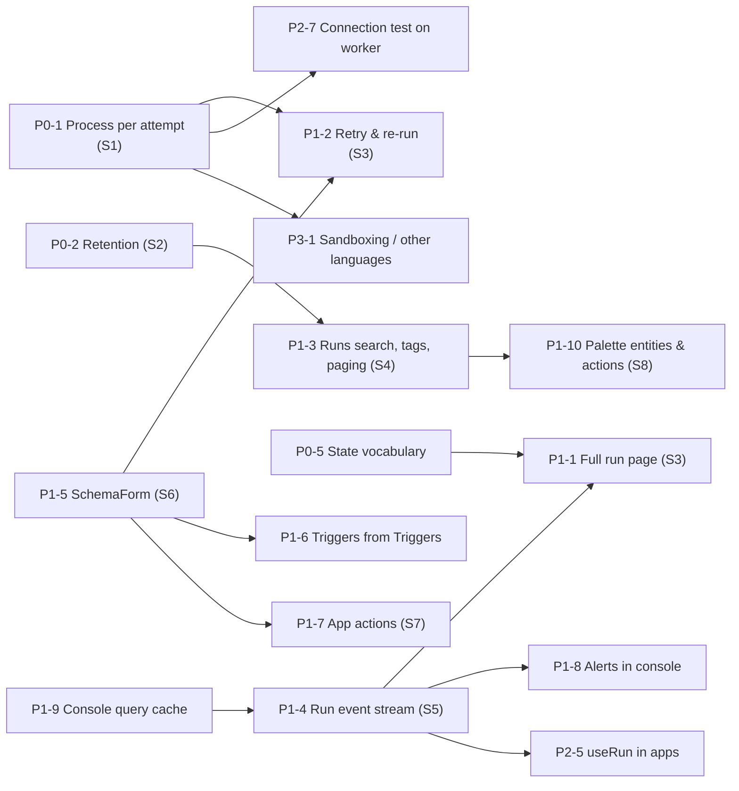

# 7. Prioritized implementation roadmap

**Priorities:**
- **P0** foundational corrections
- **P1** maturity of existing features
- **P2** platform expansion
- **P3** advanced

**Complexity:** S is up to 3 days, M up to 2 weeks, L up to 6 weeks, XL more than that, for one engineer who knows the code base.

⚡ marks a quick win: small effort and immediate user value.

Specs referenced as **S1–S8** are in [specs/](specs/).

## Sequencing

**Build order:**
1. **Quick wins** in parallel with anything: P0-3, P0-4, P0-6, P1-11.
2. **P0-1 and P0-2.** Execution and retention are the riskiest debts.
3. **P0-5, then P1-9, then P1-4.** One vocabulary, then a cache, then the stream. Every live screen afterward is cheap.
4. **P1-1 / P1-2 / P1-3**, the operational loop. These share the run page.
5. **P1-5, then P1-6 and P1-7**, the build loop. SchemaForm unlocks both.
6. **P1-8, P1-10, P1-12**, then the P2 items by client demand.

---

## P0: Foundational corrections

### P0-1 Hard timeouts and worker isolation (S1)
- **Problem.** Code that ignores `ctx.signal` keeps running after its timeout or cancel. Up to 4 runs share one process with no memory cap. Managed workers run beside the control plane as the same uid.
- **Current implementation.**
  - `packages/worker/src/worker.ts:202-221, 426-430`: `import()` in-process, then `Promise.race`.
  - `apps/control-plane/src/kernel/execution/supervisor.ts:64-96`: a child with a stripped env, same container and user.
- **Proposed solution.**
  - Run each attempt in a child process (`child_process.fork` of a small runner), killed with SIGKILL at `timeoutSeconds + grace` or on cancel.
  - Memory cap through `--max-old-space-size` per script (manifest `memoryMb`, default 512).
  - Managed workers run as an unprivileged `vxrun` user (owner decision, 2026-11-14); the image grants `CAP_SETUID`/`CAP_SETGID` for this. Without that capability, managed workers are refused for tenants whose `code:write` is held outside the operator, and the console says so.
- **User benefit.**
  - "Timed out" and "Canceled" become true.
  - A runaway script can't slow its neighbors.
  - Client developers can be given code access safely.
- **Architecture.**
  - The worker protocol is unchanged; this is internal to the worker.
  - The module cache moves into the child, which fixes A14: modules never evicted.
  - Startup cost is about 50–150 ms per attempt. Pre-forked warm runners can come later.
- **Modules.** `packages/worker/src/worker.ts`, new `packages/worker/src/runner.ts`, `supervisor.ts`, `packages/manifest/src/kinds.ts` (`memoryMb`), `docs/contracts/worker-protocol.md` (note), `SECURITY.md`.
- **Complexity.** M.
- **Dependencies.** None.
- **Risks.**
  - Per-run latency.
  - `ctx.*` calls must be proxied over IPC to the parent, which holds the worker credential.
  - Mitigation, and a gain: today the script runs in a process whose environment holds `PLATFORM_WORKER_TOKEN`, a tenant-wide credential that can claim any workspace's jobs. Proxying means script code never sees it.
- **Justification.** It blocks P1-2 (a retry while the "failed" attempt is still running is unsafe), P2-7 and P3-1, and it is the security precondition for phase 7's `code:write`.
- **Acceptance criteria.** See S1.

### P0-2 Retention and pruning (S2)
- **Problem.** No row in `run`, `run_log`, `step_run`, `flow_run`, `event` or `webhook_refusal` is ever deleted, and neither are their S3 payloads. The audit log can't be pruned at all. The spec requires retention per tenant (`docs/master-spec.md:546-551`) and leaves the default open (`:749`).
- **Current implementation.** None.
- **Proposed solution.**
  - A tenant setting with an instance default: runs 30 days, events 30 days, refusals 7 days, audit 400 days.
  - A background job prunes in batches, run-centric so logs, steps and payloads go with their run.
  - Audit moves to monthly partitions; whole partitions older than the policy are detached and dropped (or exported to S3 first). The append-only triggers stay on each partition.
- **User benefit.** A shared instance whose database stays bounded; an explicit retention promise to clients.
- **Architecture.** A new migration partitions `audit_entry` (a one-time copy). Pruning runs in `background.ts` with an advisory lock, so only one replica prunes.
- **Modules.** `packages/db/migrations`, `kernel/execution/background.ts`, new `kernel/retention.ts`, `routes/tenants.ts` (setting), `WorkspaceSettings`/tenant settings UI, `docs/self-hosting.md`.
- **Complexity.** M (L if audit partitioning is done online).
- **Dependencies.** None. The defaults above were confirmed by the owner on 2026-11-14.
- **Risks.** Deleting evidence a client expected to keep. Mitigation: defaults announced in the changelog, a per-tenant override, and export before drop for audit.
- **Justification.** Unbounded growth is a reliability failure on the shared instance, and the spec requires retention.

### P0-3 ⚡ Stop dropping logs silently
- **Problem.** A failed log flush is swallowed (`worker.ts:232` `.catch(() => {})`), so a run can look complete without its evidence.
- **Proposed solution.**
  - Keep unflushed entries and retry them on the next heartbeat (bounded at 5,000 entries).
  - If entries are still pending at completion, send a `logs_lost: n` count with `complete`/`fail` and show "n log lines could not be saved" on the run.
- **Benefit.** The run view's evidence is trustworthy.
- **Modules.** `packages/worker/src/worker.ts`, the `/worker/runs/:id/complete|fail` schema in `routes/worker.ts`, `Runs.tsx`.
- **Complexity.** S.
- **Dependencies.** None.
- **Risks.** Memory use, mitigated by the bound.
- **Acceptance criteria.**
  - With the logs endpoint failing 3 times, then recovering, every line arrives.
  - With it failing permanently, the run shows the lost count.
  - Covered by a new `packages/worker` test (that package has none today).

### P0-4 ⚡ Remove preference noise from the audit log
- **Problem.** `PUT /me/recent` writes a `member.recent_set` audit entry on every tenant or workspace switch. That made 17 entries in one short walk, and the entries flood the tenant overview's "Recent changes". Nothing reads `/me/recent` back.
- **Proposed solution.**
  - Mark preference writes as not audited: a `config.audit: false` route flag that `http.ts`'s guard accepts only for `/me/*` preference routes.
  - Read the value on `/` to reopen the last workspace.
  - Filter preference actions out of "Recent changes".
- **Modules.** `routes/identity.ts:391-461`, `kernel/http.ts:227-243`, `apps/console/src/App.tsx:43-52`, `TenantOverview`.
- **Complexity.** S.
- **Dependencies.** None.
- **Risks.** Weakening the audit guard. Mitigation: an allowlist of exactly these routes, with a test that fails on any other.
- **Acceptance criteria.**
  - Switching workspaces 10 times adds 0 audit rows.
  - Signing in lands on the last workspace.

### P0-5 One state vocabulary
- **Problem.**
  - Three run-state label maps, with "Waiting" meaning both queued and awaiting a person (`Execution.tsx:30`, `Flows.tsx:31`, `kit/status.tsx:28`).
  - Three chip styles.
  - A flow run waiting for approval shows "Running", because `FlowRunStatus` has no waiting state (`packages/db/src/schema.ts:481`) and the view uses the raw status.
- **Proposed solution.**
  - One display state, derived on the server in `/activity` and the run endpoints: `queued`, `running`, `waiting_approval`, `waiting_time`, `succeeded`, `failed`, `canceled`.
  - One `StatePill` and one map in `kit/status.tsx`. `Badge` is for counts only, `Tag` for classification.
- **Modules.** `routes/operations.ts` (activity), `routes/flows.ts`, `apps/console/src/kit/status.tsx`, `Runs.tsx`, `Flows.tsx`, `Execution.tsx`, `Operate.tsx`.
- **Complexity.** S–M.
- **Dependencies.** None.
- **Risks.** Low.
- **Justification.** Every later run feature renders state.
- **Acceptance criteria.**
  - A grep finds one state label map.
  - A flow waiting on approval shows "Waiting for approval" on Runs, the flow run page, the overview and the tenant overview.

### P0-6 ⚡ Delete dead components; add a 404
- **Problem.**
  - `Triggers`, `Approvals`, `Events` (`Flows.tsx:798,871`) and `Changes` (`Authoring.tsx:684`, still tested) are unrouted.
  - Unknown routes fall through silently (`App.tsx:85`, `Tenant.tsx:252`).
  - A slug in a workspace URL shows "The request params is not valid."
- **Proposed solution.**
  - Delete the dead code. Keep `RunDetail` (`Execution.tsx:348`) for P1-1.
  - Add a NotFound screen.
  - Resolve slugs to IDs in console routes, or redirect.
- **Complexity.** S.
- **Acceptance criteria.**
  - `knip`/grep shows no unrouted screen exports.
  - `/t/<id>/workspaces/<slug>/runs` opens the runs.
  - `/nope` shows NotFound with a way home.

### P0-7 Shared rate limiting and single-runner background work
- **Problem.**
  - `@fastify/rate-limit` keeps counters per process (`app.ts:105`).
  - The supervisor's worker map is per replica, so N replicas can start N managed workers per tenant (Inferred).
- **Proposed solution.**
  - A Postgres-backed rate-limit store, a small table with upsert and window. No new dependency.
  - The supervisor takes a per-tenant advisory lock before starting a worker.
- **Modules.** `app.ts`, new `kernel/ratelimit.ts`, `supervisor.ts`.
- **Complexity.** S–M.
- **Risks.** Extra database writes on webhooks. Only limited routes use it.
- **Acceptance criteria.** With two replicas, a webhook limited to 120/min refuses the 121st request across both; a tenant has at most one managed worker.

---

## P1: Maturity of what exists

### P1-1 Full-page run view (S3)
- **Problem.**
  - Run detail exists only in a 22–26 rem inspector. Logs wrap to about 20 characters a line.
  - There's no link to code, and flow runs live on a separate, older page.
- **Proposed solution.**
  - `/runs/:id` becomes a full page for both scripts and flows, with:
    - a header: state, target link, version link, trigger link, started by, duration, actions;
    - a left rail: attempts (scripts) or steps (flows, with the graph as a tab);
    - a main area: logs at full width, then input and output.
  - The inspector stays as a peek with **Open full view**. `RunDetail` is the starting point.
- **Benefit.** Debugging happens in one place, with every related object one click away.
- **Modules.** `Runs.tsx`, `Execution.tsx`, `Flows.tsx` (`FlowRunView`), `FlowGraph.tsx`, routes in `Tenant.tsx`.
- **Complexity.** M.
- **Dependencies.** P0-5. Best after P1-4.
- **Risks.** Two run views diverging. Make `/flow-runs/:id` redirect.
- **Acceptance criteria.** See S3.

### P1-2 Re-run with edited input; retry flow from failed step (S3)
- **Problem.** "Run again" re-sends the same input; flow runs have no retry at all.
- **Proposed solution.**
  - **Re-run ▾** offers *same input* or *edit input*, using SchemaForm prefilled from the run.
  - Flows get **Retry from failed step**: a new flow run on the **same bundle**, linked to the original with `retry_of`. It copies the succeeded steps' outputs and starts at the failed nodes.
  - **Re-run from start** is offered too.
- **Benefit.** Recovery takes 1–2 clicks instead of about 6, and recovering doesn't mean redoing completed side effects.
- **Architecture.**
  - `startFlowRun` gains a `resumeFrom` seed: it inserts `step_run` rows marked `succeeded` with the copied outputs (flagged `detail.copied=true`), then `advance()` runs as normal.
  - Granted approvals upstream of the failure **are** copied, keeping who approved (owner decision, 2026-11-14). Pending or rejected approvals are asked again.
- **Modules.** `kernel/flows/engine.ts:62` (`startFlowRun`), `routes/flows.ts`, `routes/execution.ts` (re-run with input), migration (`flow_run.retry_of`), `Runs.tsx`.
- **Complexity.** M.
- **Dependencies.** P0-1, P1-5.
- **Risks.**
  - Re-executing non-idempotent steps. Mitigation: retry starts only at failed nodes and their downstream; the UI states which steps will run again.
- **Acceptance criteria.** See S3.

### P1-3 Runs search, tags and paging (S4)
- **Problem.** The list is capped at 100 rows. There is no search, filters aren't in the URL, and the error isn't shown in the list. The spec says runs are searchable.
- **Proposed solution.**
  - Cursor paging on `/activity`.
  - `q` searches path, run ID, tag and error text.
  - `tags` filter.
  - Filters live in the URL.
  - An error summary column.
  - `ctx.run.tag("order:1234")` and `tags` on triggers (for example from the webhook body by CEL).
- **Modules.** Migration (`run.tags text[]`, `flow_run.tags`, `error_summary` generated column, GIN and trigram indexes), `routes/operations.ts`, `packages/sdk/src/context.ts`, the worker `ctx`, `Runs.tsx`.
- **Complexity.** M.
- **Dependencies.** P0-2, so indexes stay small.
- **Risks.** Index size, bounded by retention.
- **Acceptance criteria.** See S4.

### P1-4 Run event stream (S5)
- **Problem.** Polling in four places. Overview, approvals, shell counts and waiting flow runs go stale.
- **Proposed solution.** `NOTIFY run_events` from status changes in `runs.ts` and `engine.ts`, fanned out by each replica to `GET W/stream` (SSE), filtered by the subscriber's permissions.
- **Modules.** New `kernel/stream.ts`, `routes/stream.ts`, `runs.ts`, `engine.ts`, the console `useStream`.
- **Complexity.** M.
- **Dependencies.** P1-9 (cache to invalidate).
- **Acceptance criteria.** See S5.

### P1-5 SchemaForm everywhere; derive console schemas from zod (S6)
- **Problem.** JSON input in Try it, Start flow, schedules and the flow editor ("Run by hand" sends `{}`). `InputDialog` handles flat schemas only. Console scripts need the JSON Schema written by hand, apart from the TypeScript.
- **Proposed solution.**
  - `@vynxlabs/ui` `SchemaForm` covering objects, arrays, enums, formats (date, email, uri), `oneOf` as a select, and a JSON toggle.
  - In console code, an `export const input = z.object(...)` is compiled by `packages/compose` into the manifest's schema, as the CLI does. The textarea becomes read-only "generated".
- **Modules.** `packages/ui/src/Form*`, `InputDialog.tsx`, `Authoring.tsx`, `Flows.tsx`, `FlowEditor.tsx`, `ResourceEditor.tsx`, `packages/compose`.
- **Complexity.** M.
- **Dependencies.** None.
- **Acceptance criteria.** See S6.

### P1-6 Create triggers from Triggers; schedule preview and fire now
- **Problem.**
  - Triggers can't create anything, and creation hides in "All resources".
  - The schedule form takes free-text cron and time zone, and JSON input.
  - Standalone schedules can start scripts only.
- **Proposed solution.**
  - **New trigger ▾** on Triggers.
  - In the schedule form: the next 5 fire times (`cron-parser`, already a dependency) and a time zone combobox (`Intl.supportedValuesOf('timeZone')`).
  - Input drawn with SchemaForm from the chosen target.
  - Target = script **or flow**.
  - **Fire now** on a schedule row.
  - Overlap: *skip if the previous run is still going*, as an option.
- **Modules.** `Operate.tsx` (`TriggersWorkbench`), `ResourceEditor.tsx:440`, `packages/manifest` schedule kind (`target`, `overlap`), `kernel/execution/triggers.ts`.
- **Complexity.** M.
- **Dependencies.** P1-5.
- **Risks.** A manifest change, so bump the kind schema version with compatibility.
- **Acceptance criteria.**
  - A schedule for a flow can be made from Triggers in 5 clicks.
  - An invalid cron is refused before saving.
  - The preview matches `trigger_state.next_fire_at` after deploy.
  - Fire now starts one run, marked `trigger_type=schedule, detail.manual=true`.

### P1-7 App Builder action widget (S7)
- **Problem.** No-code apps can't run a script or flow (Journey 7). This is the main missing bridge between apps and automation.
- **Proposed solution.**
  - An **Action** widget (a button) and a **row action** on Table, bound to a script or flow.
  - An input mapping by dotted path from the selected row or page filters, or a constant (owner decision, 2026-11-14: path mapping first, CEL later), plus a SchemaForm for the remaining fields.
  - Optional confirmation text.
  - Toast with the result and a link to the run (members) or to the success message (end users).
  - Authorization through the existing bindings: the viewer must be allowed to start that target.
- **Modules.** `packages/screens` (widget and runtime), `screens/Interfaces.tsx`, `packages/manifest` interface kind, the `@vynxlabs/app` client (`runScript`/`startFlow`, already there).
- **Complexity.** M.
- **Dependencies.** P1-5.
- **Acceptance criteria.** See S7.

### P1-8 Alerts in the console
- **Problem.** `onFailure` handlers and notify connections work (`kernel/execution/alerts.ts`), but the console doesn't show or configure them.
- **Proposed solution.**
  - **Configure → Alerts** with the workspace default (handler script, notify connection) and per-resource overrides, read from manifests.
  - **Recent alerts** (runs where `alert` is set).
  - Dedupe: one alert per resource per 10 minutes with a count.
- **Modules.** `alerts.ts`, a new screen, `routes/operations.ts`.
- **Complexity.** S–M.
- **Dependencies.** P1-4 for live.
- **Acceptance criteria.**
  - Setting a workspace default in the console takes effect for the next failure.
  - The alerts page lists it with a link to the run.

### P1-9 Console query cache
- **Problem.** `useLoad` has no cache, deduplication or invalidation (`api.ts:68`).
- **Proposed solution.**
  - TanStack Query (listed as "not built" in phase 7) behind `useLoad`'s signature, so screens migrate gradually.
  - Writes invalidate by key prefix.
- **Complexity.** M.
- **Dependencies.** None.
- **Risks.** A wide refactor. Mitigation: the adapter keeps the old signature.
- **Acceptance criteria.**
  - Approving on the tenant queue updates the overview count without a reload.
  - The network panel shows one request per key per screen.

### P1-10 Command palette with entities and actions (S8)
- **Problem.** ⌘K finds screens only. "reminders" returns nothing (Observed).
- **Proposed solution.**
  - Index: scripts, flows, apps, tables, triggers, connections in the current tenant; runs by ID.
  - Actions: run script, start flow (opens the SchemaForm), pause trigger, switch workspace, new script or flow, toggle theme.
  - Recent items first.
  - Prefixes `>` (runs) and `#` (resources).
- **Modules.** `kit/CommandPalette.tsx`, `Shell.tsx:532`, new `GET /tenants/:t/search`.
- **Complexity.** M.
- **Dependencies.** P1-3 (run lookup).
- **Acceptance criteria.** See S8.

### P1-11 ⚡ Small links that close loops
- The failed-runs chip and the overview "Open runs" carry `?status=failed`; chip changes write to the URL.
- Copy buttons on run, event and step IDs (`CopyButton`, `ListScreen.tsx:342`); **Copy as curl** on runs and webhooks.
- Run Details: version, script and trigger become links.
- The repository script view scrolls to "Defined at line N", with corrected copy.
- The flow run graph fits to view on open.
- Triggers rows link to their target; empty states offer both console and CLI paths.
- `ConnectionGroups` shows an empty state.
- **Complexity.** S each. **Acceptance criteria:** each closes the matching item in [04-ux-audit.md](04-ux-audit.md) (X2, X6, D5, D6, IA2, V5, V6).

### P1-12 Queue panel and RED metrics
- **Problem.** No queue view; only 4 gauges.
- **Proposed solution.**
  - **Tenant → Workers** shows queued count and oldest age per workspace and pool, running jobs per worker, and worker version.
  - `/metrics` adds:
    - histograms of run duration and queue wait by workspace;
    - counters of runs by final state;
    - flow runs by state;
    - webhook refusals.
- **Modules.** `routes/execution.ts:2124-2170`, `routes/pools.ts`, `Execution.tsx` (Workers).
- **Complexity.** M.
- **Acceptance criteria.** A queued backlog in one workspace is visible on the Workers screen and in `/metrics` within one scrape.

---

## P2: Platform expansion

| ID | Item | Problem → proposal | Modules | Cx | Depends | Risks | Acceptance |
| --- | --- | --- | --- | --- | --- | --- | --- |
| P2-1 | **Flow editor test panel and expression preview** | No test with input, no step test, CEL with no feedback → a bottom panel runs the draft with SchemaForm input; step results overlay the nodes; CEL fields evaluate against the last test run; undo and redo | `FlowEditor.tsx`, `FlowSteps.tsx`, `routes/authoring.ts` (test flow runs), `expressions.ts` | L | P1-5, P1-4 | Test runs with side effects: label them, and use dev workspaces only | A draft flow runs with typed input without leaving the editor; a CEL field shows its value or error |
| P2-2 | **Connection wizard with Test on a worker** | Declare, bind and use split across 3 areas, no test → one wizard; **Test** runs a platform `connection-test` run on the workspace's pool and keeps the result as health | `Execution.tsx`, `ResourceEditor.tsx`, `kernel/execution/connectors.ts`, `health.ts`, worker | M | P0-1 | Tests that call production systems: user-triggered only | A wrong credential fails the test with the HTTP status before any script runs |
| P2-3 | **Request promotion** | Developers can't promote and can't ask → "Request promotion" creates a pending item for holders of `promotion:write`, shown in tenant "Needs attention" and decided in place | `Release.tsx`, `promote.ts`, approvals UI | M | — | — | A request appears for a promoter within one refresh and promotes the requested deployment |
| P2-4 | **`platform pull`, `platform run --remote`, `platform logs -f`** | Console edits reach the repository only by server push; local runs lack tables and events → `pull` writes drafts as files under `platform/`; `run --remote` starts a test run in a dev workspace and streams logs | `packages/cli`, `routes/git.ts`, `routes/authoring.ts` | M | P1-4 | — | A console draft round-trips: pull → edit → deploy → no diff |
| P2-5 | **`useRun` / realtime for apps** | Apps poll `runScript` → the same stream exposed to `@vynxlabs/app` with permission filtering | `packages/app`, `routes/stream.ts` | S | P1-4 | Load from end users: per-session limits | A code app shows a run's progress without polling |
| P2-6 | **Approve from a link** | Approvers must open the console → signed, single-use links in the approval mail with approve, reject and comment | `kernel/flows/approvers.ts`, `kernel/mail.ts`, a new public route | M | — | Link forwarding: bind to the approver's identity, short expiry, one use | Approving by link records the approver and comment in audit |
| P2-7 | **Concurrency key and schedule overlap** | No per-customer serialization → `concurrency: { key: "input.customerId", limit: 1 }` on scripts using pg-boss singleton keys; schedule overlap `skip` | `packages/manifest`, `runs.ts`, `triggers.ts` | M | — | Starvation: per-key limit only | Two runs for the same key never overlap |
| P2-8 | **Result renderers** | Output is JSON only → render arrays of objects as a table, `{markdown}`, image and file links, by shape | `packages/ui` (JsonView sibling), run page | S | P1-1 | — | A script returning rows shows a table with a JSON toggle |
| P2-9 | **OAuth2 connection kind** | No OAuth → authorization-code flow with refresh tokens stored as binding secrets | `packages/sdk`, `kernel/execution/connectors.ts`, `bindings.ts`, console | L | P2-2 | Token refresh races: lock per binding | A Google or Microsoft connection authorizes once and refreshes unattended |
| P2-10 | **Drift view and per-resource diff** | Promotion preview lists changes; no ongoing drift → Release shows each resource as In sync / Changed in dev / Only in prod, with a diff | `promote.ts`, `Release.tsx`, `resource_version` | M | — | — | After a dev deploy, the drift view lists exactly the changed resources |
| P2-11 | **Effective permissions view** | "Why can X do Y" is unanswerable in the UI → a member or service-account page lists permissions with the binding that grants each | `kernel/authorize.ts` (explain mode), `Members.tsx` | S–M | — | — | Each permission shown links to its binding |
| P2-12 | **"Offer to an agent" and Try a tool** | MCP is hard to discover → an action on a script or flow adds a resource-scoped binding for a service account; Agent access gets a test form | `routes/mcp.ts`, `screens/Tenant.tsx` | S | P1-5 | Over-granting: resource scope only | The tool appears in the account's list and runs from the form |
| P2-13 | **Master key rotation** | No rotation → re-wrap every `tenant_key` under a new `MASTER_KEY` with an instance command; both keys accepted during rotation | `kernel/crypto.ts`, `secrets.ts`, a CLI or startup flag | M | — | Partial rotation: resumable and idempotent | After rotation, the old key can be removed and every secret still decrypts |

---

## P3: Advanced capabilities

| ID | Item | Why it's valuable | Why later | Cx | Depends |
| --- | --- | --- | --- | --- | --- |
| P3-1 | **Sandboxed execution** (gVisor or Firecracker workers, or `isolated-vm` for core nodes) | Untrusted authors; required before any "public" authoring | A spec non-goal today; P0-1 gets most of the value cheaply | XL | P0-1 |
| P3-2 | **Second language worker** (Python) | Data and ETL work from clients | The spec defers it; protocol is ready (`docs/contracts/worker-protocol.md`) | XL | P0-1 |
| P3-3 | **OpenTelemetry traces** across control plane, worker and HTTP calls from `ctx.connection` | One trace per run with spans, exportable | P1-12 metrics first; tracing adds a collector to deployments | L | P1-12 |
| P3-4 | **Operator-configured AI assistant** ("Explain this failure", "Draft a script") through the tenant's own model connection | Faster authoring and triage | Must respect "no call home"; best once run pages and schemas are solid | L | P1-1, P1-5 |
| P3-5 | **Bulk operations** (re-run or cancel by filter, with a progress page) | Incident recovery at volume | Needs search and paging first | M | P1-3 |
| P3-6 | **Schedule backfill** | Re-running missed periods for ETL | Rare need; overlap and fire-now first | M | P1-6 |
| P3-7 | **Connector recipes** | Faster delivery for common client systems | Content, not platform; do it as client work repeats | ongoing | P2-9 |

## Quick wins

| ID | Effort | Effect |
| --- | --- | --- |
| P0-3 | S | Trustworthy logs |
| P0-4 | S | Clean audit; land on the last workspace |
| P0-6 | S | Less dead code; clear 404s; readable URLs |
| P1-11 | S each | Removes five dead ends found in the journeys |
| P2-5 | S (after P1-4) | Realtime in apps |
| P2-8 | S | Readable outputs |
| P2-12 | S | MCP becomes discoverable |
