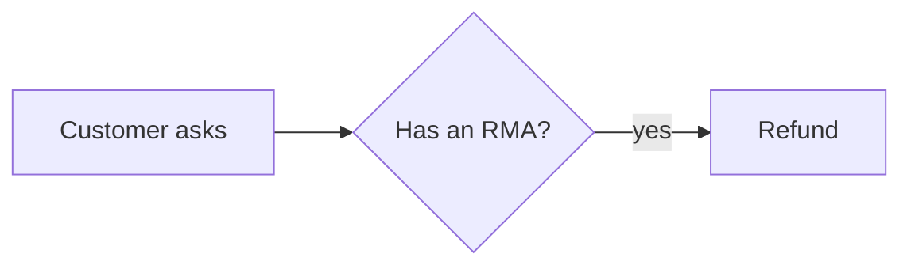

# Writing a tenant repository: names, files and access

Last updated: 2026-11-22. The SDK's types document each option, and `schemas/` holds the machine-readable form of everything here.

## A resource has three names

| Name | What it is | Changes? |
| --- | --- | --- |
| `key` | The resource's identity | Never |
| `path` | Its address and folder | Yes: that is a rename |
| `title` | What people read | Freely |

Most resources never say a key: it is the path they were made at.

### Moving a resource

Change `path`, and say `key`: the path it had.

```ts
export const submit = defineScript({
  path: "lending/requests/file",
  key: "requests/submit",
  title: "Submit a device request",
  // …
});
```

The deploy reports `renamed script requests/submit -> lending/requests/file`. It is the same resource: its run history, its rows if it is a table, what the workspace bound to it and what it was given access to all stay. `requests/submit` keeps answering for 90 days, with `Deprecation`, `Sunset` and `Volvel-Resource-Moved` on the answer.

Without `key` a new path is a delete and a create. The instance refuses that when the old resource holds runs, rows or access given by hand, and tells you the key to add. `--allow-delete <path>` is for when you mean it.

A key is unique in the workspace and is never reused while its resource lives. Something new at a path a moved resource had must say a key of its own; the build tells you.

### References

Pass the definition where you can: `tables: [items]`, `script: submit`. It carries the path, so a rename needs nothing more.

A reference written as text is a path. If it is the key of a resource that has moved, the build uses the new path, and `volvel deploy` prints a note (`volvel build` does not), so old text keeps building while you tidy up.

## The name of an agent's tool

A script, and a flow with a manual trigger, are tools an agent can call over MCP. By default the name is made from the path: `run_requests__submit`. Choose one for anything an agent is configured to call:

```ts
defineScript({ path: "requests/submit", mcp: { name: "submit_device_request" }, … });
```

The agent sees exactly that, and it does not change when the path does. Changing a chosen name, or choosing one for a script that already has a tool, changes what the agent must call at once: the deploy lists it under "Breaking", and promoting it to production has to be confirmed (`--confirm-breaking`).

## TypeScript or YAML

A resource has one owner: the code that defines it, or a file. Which one decides who may change it.

| | Defined in TypeScript | Kept as a file |
| --- | --- | --- |
| Changed by | Editing the code and deploying the repository | Editing the file, or editing it in the console |
| In git sync | No. Sync never reads or writes TypeScript | Yes |
| Right for | Tables, scripts and flows that share code | What has no code: apps, screens, themes, variables, schedules, triggers, connections |

The console cannot edit TypeScript. Saving a draft of something the code defines, and deploying it, **takes it over**: it becomes a file the console owns, with the same key, history and bindings. The definition is still in your code, so the next `volvel deploy` takes it back, and so on until you remove it from one side. A script the code defines cannot be taken over at all, because its code leans on the rest of yours: the console can only replace it with one written there, at the same path.

Keep what the console should edit as files from the start and none of this comes up.

Write resources in TypeScript when you have many, want types, or generate them with code. Write one as a file when someone will also edit it in the console.

A file is `<name>.<kind>.yaml`:

```yaml
# platform/lending/limit.variable.yaml
title: Lending limit
schemaVersion: 1
body:
  default: "5"
```

- A script, connector or trigger source keeps its code beside the file, as `<name>.<kind>.ts`. That code may import only `@volvel/sdk` and `node:` modules.
- Files can be kept anywhere. Under `platform/`, or under a folder listed in `volvel.yaml`, a file's path is where it is. Anywhere else it says `path:`.
- A file may say `key:` and `title:` beside its body.
- Write comments in these files and order them as you like. When the console changes one, only what it changed is rewritten; your comments and your order stay. A comment inside a list stays at its position in the list.
- `volvel schemas` makes your editor complete and check these files as you type. It writes each kind's schema to `.platform/schemas/` and adds the mapping to `.vscode/settings.json`, for the YAML extension of VS Code. Run it again after upgrading the CLI.
- In the console, the editor of a resource that code defines offers "Move to a file" for the kinds without code. Once that is deployed, remove the definition from the code: a deploy that still has it takes the resource back.

```yaml
# volvel.yaml, at the repository's root
roots: [src]
ignore: [vendor]
```

The console edits these files wherever you keep them. With git sync, a change made in the console is committed to the file it came from, on the workspace's branch; a rename moves the file, or changes its `path:` if it says one. A resource made in the console is written under `platform/`.

- A file is rewritten only when the resource was changed in the console. Then only what changed is rewritten, onto the file as you wrote it: your comments and your order stay, as above.
- Without git sync, `volvel pull` writes the console's changes into the same files. It does not overwrite one you changed and never pulled unless you pass `--force`.
- Code is different. A resource made by `define*` in TypeScript is not a file the console can write, and the console shows it read-only.

A resource is defined once. The build refuses one that is both in the code and in a file, by path or by key, and names both places.

## A tenant's access

Groups, service accounts, the tenant's own roles and what each is given can live in the repository, as files named for their kind:

```
tenant/
  groups/tech-desk.group.yaml
  end-user-groups/students.end_user_group.yaml
  service-accounts/helpdesk-assistant.service_account.yaml
  roles/device_lender.tenant_role.yaml
  bindings/desk-lends.tenant_binding.yaml
```

```yaml
# tenant/groups/tech-desk.group.yaml
title: Tech Desk
schemaVersion: 1
body:
  description: Staff who decide device requests.
  membership:
    sso:
      values: [it-tech-desk]   # whoever signs in with this in the provider's groups claim
```

```yaml
# tenant/bindings/desk-lends.tenant_binding.yaml
schemaVersion: 1
body:
  role: device_lender
  principal: { type: group, key: tech-desk }
  workspace: devices          # leave out for the whole tenant
```

The file's name is the key. Who is in a group is never in the repository: people belong to the identity provider.

```sh
volvel tenant plan --tenant <slug>      # what a release would change
volvel tenant release --tenant <slug>
volvel tenant pull --tenant <slug>      # write what the tenant has now
```

A release makes the tenant's access what the files say. It removes what the files lack only with `--allow-delete <kind>/<key>`, and never while a workspace's bundle still gives the group or service account access. If the tenant asks for a second person, the release waits until someone else approves it (`volvel tenant approve <number>`).

Then name them by key in the workspace's code, so that what they are called can change:

```ts
defineBinding({ path: "access/desk", role: "viewer", principal: { type: "group", key: "tech-desk" } });
step.approval("Lend a device", { approvers: { groups: ["tech-desk"] } });
```

A row that belongs to a group should hold the group's key. A text column checked with `in: "groups"` matches the key, and still matches what the group is called.

## Tables: choices, references and questions

**A column that holds a choice** is an enum. Its row type is the values themselves, so a script that writes a value the column does not have fails to compile, and the database refuses whatever gets past that.

```ts
export const loans = defineTable({
  path: "loans",
  display: "number",
  columns: {
    number: column.text({ required: true, unique: true }),
    status: column.enum(
      ["out", { value: "returned", label: "Returned", color: "green" }],
      { required: true, default: "out" },
    ),
    extras: column.enumList(["charger", "case"]),
    device: column.reference(devices, { onDelete: "set_null" }),
  },
});
```

- Take a value out and the rows that hold it keep it; nobody is offered it again.
- Spell a value anew with `renamedFrom` and every row is rewritten in the deploy.
- A colour is `gray`, `red`, `orange`, `amber`, `green`, `teal`, `blue`, `violet` or `pink`, or any `#rrggbb`. The text over it is black or white, whichever reads better.
- `onDelete` is `restrict` (the default: deleting a row that is pointed to is refused), `set_null` or `cascade`.
- `display` is the column shown where another table points to a row of this one.

**A question across tables** is a query: one SELECT, kept by name.

```ts
export const feesByDevice = defineQuery({
  path: "reports/fees",
  sql: `select d.name, sum(l.fee) as fees
        from loans l join devices d on d.id = l.device
        where l.fee >= $1 group by d.name order by fees desc`,
  parameters: [{ name: "least", type: "integer", default: 0 }],
});
```

- A table is named by its path, in double quotes when it has a `/` or a `-`: `"lending/loans"`.
- A query reads. It cannot change a row, name a table that is not the workspace's, or call a function outside the list `GET …/queries/schema` gives.
- Whoever runs it needs `data:read` on each table it names, and gets the rows each table's policy gives them. A query over an owner's table gives each person their own rows.
- Two columns of the same name are both kept, in the order written, and a whole number too large for a double (over 2^53) comes back as text. Name columns apart with `as` when a page binds them by name. A table whose path is over 63 bytes can be put on a page but not written in SQL.

**A dashboard** is a file: filters, and widgets that each ask a query. It deploys and promotes like any other resource, and whoever opens it gets the rows each table's policy gives them.

```yaml
# platform/reports/lending.dashboard.yaml
schemaVersion: 1
body:
  version: 2
  title: Lending
  filters:
    - { name: lent, label: Checked out, type: date_range, default: last_90_days }
  widgets:
    - id: by-month
      title: Loans by month and status
      type: pivot
      at: { x: 0, y: 0, w: 12, h: 7 }
      source:
        visual:
          table: loans
          groupBy: [{ column: checked_out_at, bucket: month }, { column: status }]
          measures: [{ fn: count, as: loans }]
      filters: [{ filter: lent, column: checked_out_at }]
      options: { rows: [checked_out_at_month], columns: [status], value: loans, cell: sum }
    - id: saved
      type: table
      source: { query: reports/loans-by-month }
      filters: [{ filter: lent, parameter: since, part: from }]
```

- A widget's `source` is one of three: `visual` (a table, groups and measures, which the platform writes as SQL), `query` (a saved query by its path) or `sql` (written in the widget: a draft or a deploy made in the console needs `sql:read`, a repository deploy does not).
- A widget is a `figure`, `chart`, `table`, `pivot` or `text`.
- `at` is where a widget is on the page's twelve columns and how big: `x` and `y` are where it starts, `w` and `h` its size, in cells, and a row is 40 pixels tall. In the console the same thing is set by dragging. A widget with no `at` is laid in rows after the others, in order; `width` (3, 4, 6, 8 or 12), from before widgets had places, is still read.
- `refresh` on the dashboard is how often its widgets ask again while it is on show, in minutes: `off`, 1, 5, 15 or 60. Left out, 5.
- A widget's `subtitle` is a line under its title.
- **A figure** compared with `compareTo` says the change as a share, or as `delta: absolute` or `delta: points` (for a rate). `goodWhen: down` makes a fall the good news. `trend: { by: <a date column> }` draws how the number went as a small line: for a `visual` source the platform asks the same question a day, a week or a month at a time; for a saved query or SQL the widget's own rows are the line and the figure is the last of them. `caption` is a line of your own, where `{previous}` is the number for the period before.
- **A chart**'s `mark` is `bar`, `line`, `area`, `pie`, `scatter` or `heatmap` (`x`, `y` and the `value` that shades each square). `horizontal: true` lays bars down. `compare: true` with `compareTo` draws the period before as a dashed line.
- **A table**'s `cells` say how a column is headed, written and drawn: `{ column, label, format, as }`, where `as` is `text`, `bar`, `delta` or `chip`. `totals: true` adds a row of totals.
- A filter reaches a widget only where the widget binds it: to a `column` of its table, or to a `parameter` of its query.
- A date grouped by `month` comes back as `<column>_month`.
- The easiest way to write one is to build it in the console and choose **Keep it as a resource**.

## Documentation

A workspace's documentation is pages of Markdown, kept in the repository beside everything else and served as a site.

### A page is a file

A page is a Markdown file in the folder of pages, which is `platform/docs` unless `volvel.yaml` names others:

```yaml
# volvel.yaml
docs: [docs]
```

Under that folder, a file's place is its path: `docs/handbook/support/refunds.md` is the page `handbook/support/refunds`. A file's name is never changed to make it fit, so name files in lowercase letters, digits, hyphens and underscores. Markdown anywhere else in the repository is nobody's page.

A page says what it is at its top:

```md
---
title: Refund an order
description: How support issues a full or partial refund.
topic: support-refunds
terms:
  - id: rma
    term: RMA
    short: A return authorisation, issued before a refund.
about:
  - table: sales/orders
extends: [data-tables]
---

Ask for the :term[RMA]{id=rma} first.
```

- `pages`, on a folder's own page (`index.md`), lists the order of what is in the folder by name: a page's file name without `.md`, a folder's own name. What it does not list comes after, by title.
- `topic` is a name that stays when the page moves. Link to it as `[refunds](topic:support-refunds)`.
- `terms` are glossary terms the page defines. Any page of the workspace can use one with `:term[RMA]{id=rma}`, and the console underlines it where a heading or a description uses the word.
- `about` lists resources the page documents. The page is listed on each one's screen in the console.
- `extends` adds the page to a topic of the product's own help, under "From your team".
- `key` keeps the page the same page when you move its file: give it the path it had.

### An app serves a folder

```ts
export const handbook = defineApp({ path: "handbook", title: "Handbook", docs: "handbook" });
export const open = defineBinding({
  path: "access/handbook",
  role: "portal_user",
  principal: { type: "anonymous" },
  resource: handbook,
});
```

Every page whose path is under `handbook` is a page of the site, and `handbook` is a top-level folder: a site never serves a folder inside another. `index` is its home page, each folder directly under it is a collection, and folders inside them go as deep as they are written. A folder's own page with nothing written in it lists what is in the folder. Who may open the site is decided by bindings, as for any app: nobody outside without one.

A site can ask its readers whether a page helped, and keep each answer as a row of a table of yours. A workspace keeps the answers of all its sites in one table, `docs-feedback`, where each row says which site it is from by `site_key`, the key of the site's app, which a rename keeps:

```ts
export const votes = defineTable({
  path: "docs-feedback",
  columns: {
    site_key: column.text({ required: true }),
    site: column.text(),
    page: column.text({ required: true }),
    helpful: column.boolean({ required: true }),
    version: column.text(),
    at: column.timestamp(),
  },
});
export const handbook = defineApp({
  path: "handbook",
  title: "Handbook",
  docs: "handbook",
  feedback: { table: "docs-feedback" },
});
```

A deploy refuses a site whose table is not there or lacks those columns. Nothing about who answered is kept, and a reader answers once for each page.

A picture kept beside the pages, `docs/handbook/img/till.png`, is written `` from the home page. A picture by `https` address is allowed too, and is not shown offline.

### Components

What Markdown cannot say is written one way, whichever component it is:

```md
:::alert[Before you start]{type=warning}
A refund over 500 needs a second person.
:::

:::tabs
::::tab{label="Card"}
Refund to the card.
::::
::::tab{label="Cash"}
Refund at the till.
::::
:::
```

The components are `alert`, `term`, `field`, `steps`, `tabs` and `tab`, `details`, `kbd`, `code-tabs`, `file-tree` and `pages`. Each may sit inside any other, as deep as you like: a container inside another is written with more colons, so that it reads as inside it, and a container inside a list item is indented with the item's words. Only a `tab` goes in `tabs`, and `code-tabs` holds code blocks. `::pages` lists what is in the page's folder, and `::glossary` every term the pages of the page's collection define, from A to Z, with the page that defines each (`::glossary{scope=site}` for the whole site's). Every instance lists what each takes in its help, under Reference. There is no HTML in a page and nothing in it runs.

A block of code written as `mermaid` is a diagram:

````md

````

It is drawn in the site's own colours, again when the reader's theme changes, and the reader can move and zoom it: drag, ⌘ or Ctrl and scroll, two fingers, or the keys + − 0 and the arrows. Without script it is its source. Mermaid is served by the instance, and fetched only by a page that has a diagram.

### What columns and resources are for

A column takes a `description`, and so do a schedule, a trigger and a binding:

```ts
status: column.text({ description: "Where the order is in its life." }),
```

A column's description is shown behind an ⓘ on its heading, in the console and in apps, to whoever may read the table. `:term[status]{table=sales/orders column=status}` in a page draws on the same words.

### Help from an app

A page of an interface can name a topic as its help. Whoever uses the app, and may open the documentation, gets a Help button that shows the page.

An app written as code has the same from `@volvel/app`:

```tsx
import { HelpPanel } from "@volvel/app";

<HelpPanel topic="support-refunds" />
```

It is a button that opens the page beside the app, as its docs app serves it. It draws nothing when no page has the topic or the person may not open it, so it can go on a screen before its help is written. Give it a `className` to make the button one of your own. Where the documentation is served at another address than the app, the button opens the page in a new tab, since one address may not show another's page inside it. `useHelp(topic)` gives the page's title and address to draw your own, `helpUrl(topic)` the address alone, and `terms()` the glossary.

### What the build checks

`volvel build` and every deploy refuse a workspace whose documentation does not hold together: a page that does not read, a link to a page or a heading that is not there, a term nobody defines, a page about a resource that is not there, two apps serving the same pages. Each is named with its page and its line.

## What the build stops

- **A definition that is not exported.** `defineScript(…)` that the entry file does not export is refused by name. Two files exporting the same name through `export *` cancel each other out: export each by name.
- **Two tools with one name**, chosen or made from the path, and a chosen name that is one of the tools every agent has. A name made from a path writes `-` as `_` and stops at 64 characters, so `desk/look-up` and `desk/look_up` are one name: give one an `mcp.name`.
- **A reference to something that is not there**, including a schedule's `flow`.
