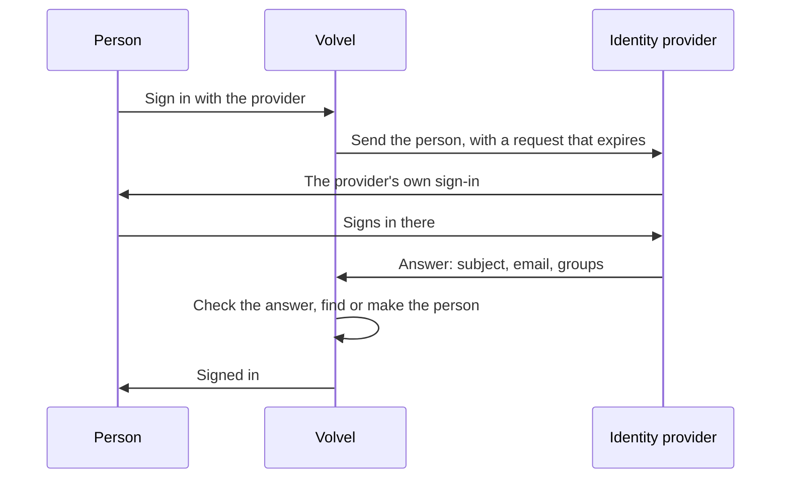

A tenant can let people sign in through the account their organization already has, instead of a password kept here. The organization's system that says who someone is, is an **identity provider**. Volvel speaks two protocols to one: OpenID Connect and SAML 2.0. This page says what happens when someone signs in through one, and why it is built that way, so that a refusal or a setting can be read.

## The idea

A provider answers one question: who is this person, and what does the organization say about them? It does not decide what the person may do here. That is decided by Volvel's roles and bindings, as for every other person. The provider supplies a lasting name for the person (the **subject**), usually an email, a name, and groups.

A provider is made for one of two kinds of people. **Members** use the console and belong to the instance as a whole. **End users** belong to one tenant and use its apps and portal. The two are kept apart because the harm of a mistake differs: a member's account can be in many tenants, and an end user's is in one.

A new provider is **Off**. Nothing changes for anyone until someone turns it on, and the console lets you try a sign-in first without signing anybody in.

## How a sign-in goes

When the answer comes back, Volvel first checks it. For OIDC the token must verify against the provider's keys. For SAML the answer must be signed by a certificate listed, name this instance as its audience and reply address, answer a request this browser began, and be used once. A request must be answered within 10 minutes. A check that fails is a refusal, and the reason is in the audit log. See [Why a sign-in is refused](../../reference/sso/refusals).

Then Volvel finds the person. If the provider's subject is already **tied** to an account, that is the person, and the email is not looked at again, so a person who changes their email at the provider keeps their account. If it is not tied, the email is used once, to find an existing account and tie the subject to it, and only when the email can be believed. If there is no account, one is made when **Create people the first time they sign in** is on, and otherwise the person is refused.

Last, Volvel sets the person's groups. On every sign-in a person is put in exactly the mapped groups the provider names for them, and taken out of the mapped groups it does not. A group that is not mapped is never touched.

## Why an email domain is proved

The tie by email is the dangerous step: whoever can make a provider say "this is ada@example.com" could become Ada. A member is one person across the whole instance, so for members Volvel believes an email only when its domain has been **proved** for the provider with a DNS record that the domain's owner published. See [How a hostname is proved](how-hostnames-are-proved), which uses the same mechanism. A domain of members belongs to one provider on the whole instance.

End users belong to one tenant, so the tenant may instead choose **Take the provider's word on emails**, for a provider that verifies emails itself. Without it, an existing end user with that email is not taken over, and the sign-in is refused.

A provider's word that an email is *not* verified is always respected.

## What requiring a provider changes

Turning a provider on adds a way in. **Require it** takes the other way away: the people the provider covers can no longer sign in with a password, and their open sessions end. Who is covered is decided by domain: members with an email in a proved domain; end users in a proved domain, or everyone when there is none. An API key is not a sign-in, and keeps working.

Two exceptions are kept on purpose. An enabled operator admin keeps a password, so that a broken or misconfigured provider cannot lock everyone out for good. And an owner of a tenant can make **recovery codes** beforehand. A code is a one-time way in with the owner's password while the provider is down. It is spent before the password is checked, so a wrong password costs the code.

## Why a tenant's provider does not sign in an operator

A person who holds any binding at the instance runs the instance. A tenant's provider is the tenant's, written by the tenant's administrators. If it could sign in an operator, a tenant administrator could make the provider say that someone was an operator's email and be that operator. So a tenant's provider refuses such a person (`runs_instance`), and a tenant's SCIM provider may not push one. The instance has a provider of its own for operators, which an operator connects: see [Connect an identity provider for operators](../../../self-host/how-to/sso/connect-an-identity-provider-for-operators).

## What is left to others

- Volvel does not give a role to a person an instance's provider signs in. It makes the account, and an operator gives access.
- Volvel does not manage the provider. People who leave the organization are turned off here when the provider says so over SCIM, or when someone turns them off. See [Provision people with SCIM](../../how-to/sso/provision-people-with-scim).
- Volvel does not issue certificates, for the provider or for hostnames.

## How it fits

The screen is [Single sign-on](../../reference/screens/single-sign-on). The steps are [Connect an OIDC provider](../../how-to/sso/connect-an-oidc-provider), [Connect a SAML provider](../../how-to/sso/connect-a-saml-provider) and [Require single sign-on](../../how-to/sso/require-single-sign-on).
