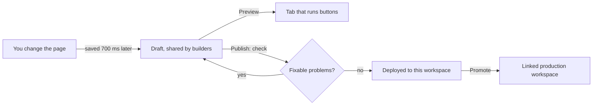

An app made in the console is made of pages of widgets that read this workspace's tables. Nobody writes code, and nobody makes a screen for each person: two people who open the same app are shown the rows their groups allow. This page explains what is kept when you make one, why more than one person can work on it, what a publish does, and where the limits of what the screen decides are. To build one, follow [Make an app](../../how-to/app-builder/make-an-app).

## The idea

An app is two resources that go together. The **interface** holds the pages, their widgets and the rules on them. The **app** is what the instance serves at an address, and it names the interface it serves. The **Make an app** dialog makes both, and the **App Builder** list shows them as one row. The interface lives at `screens/<address>` and the app at `<address>`.

The split is the same as for an app written as code, and once deployed the two kinds are the same thing: both are listed on the **Apps** screen. **Preview** draws the draft with the same component that serves the published app, so what you see there is what a reader sees, with their own rows.

A page is one of four kinds, **Page**, **Record page**, **Side sheet** or **Modal**, and holds widgets on a grid of twelve columns. A widget reads a table, or a saved query, and shows what the person who opened the app may read. The widgets and their rules are in [the settings pane](../../reference/app-builder/inspector).

## A draft belongs to the workspace

Everything you change in the workbench is saved as a **draft**: a copy of the interface that is not deployed. A draft is not yours. It belongs to the workspace, and anyone who may write there sees it and can change it. The **Make an app** dialog says so: "Other builders of this workspace see the draft; people who use the app see nothing until you publish it."

Two builders in one draft could silently replace each other's work, so every save says which version of the draft it was made on, its revision. If another builder saved after you opened the app, the save is refused and nothing of theirs is overwritten. The workbench shows a notice and leaves what you changed on the screen, unsaved, until you load their version. Nothing is merged.

Each save also puts the version it replaced aside. The control plane keeps the newest 30, and **Restore an earlier draft** puts one back as a single change.

## What a publish does

**Publish** deploys two things: the interface and the app that serves it. It does not deploy a table you drafted, a script, or another app. It is deployed with the message "Deploy" and the app's title, and the live app keeps working until the deploy finishes. Before it does, the publish check says what would fail and what is worth knowing, using the workspace as it is now: whether the tables, flows, scripts and groups that the app names exist, whether each action is complete, and what the control plane would refuse.

A dev workspace is where apps are built. A production workspace is read only for apps, and an app arrives there when a version is promoted. That is why **App Builder** in production has no **Make an app**, **Rename** or **Remove**.

The canvas never runs a button. **Preview** does, and it really changes this workspace's rows, so look at what a button does before you press it.

## What the screen decides, and what it does not

The builder decides what is drawn, and the server decides what is allowed.

- **Hiding is not security.** A widget can be shown only when a condition holds, or only to some groups. That changes what is drawn. A person who is not shown a widget can still read what their groups let them read, because rows are decided by the table's row rules, not by the page. **View as** works the same way: it draws a group's view and leaves the rows yours.
- **A button is a grant.** Whoever may open the app may press its buttons, unless the action names groups under **Who can run it**. The server checks that, and a person outside the groups is refused with "Only" the groups "can do this". The check is made in the same call that runs the action. Its **Can be pressed when** is checked again against the record as it is when the button is pressed: an invoice that someone else paid a minute ago is refused with "It can't be done now:" and the condition. One action runs on at most 200 records.
- **Read what a button names before you publish.** The publish check counts the actions and says which are incomplete; it does not summarize who can press them.

## Who manages the app

An app is managed in the console or in the repository. A repository app is shown read only, and the builder offers **Take over**. After a take-over the next publish moves the app out of the repository, and the screen says that changes made there no longer reach it. See [Take over a repository app](../../how-to/app-builder/take-over-a-repository-app).

## What is not there

- **Who may open an app.** The builder has no setting for it. It is set on the **Apps** screen, under **Share**.
- **A theme for one app.** The builder has no color or theme setting.
- **Unpublish.** The list has **Remove**, which drafts the removal of the interface and its app, and **Discard draft**, which drops edits. It does not switch a published app off.
- **Filters or rules on a page.** A page has neither: filters are widgets, and who sees what is set on a widget.

## How it fits

- [App Builder](../../reference/screens/build/app-builder) lists the apps, and [Building an app](../../reference/screens/build/app-builder-editor) is the workbench.
- [Publish an app](../../how-to/app-builder/publish-an-app) walks the check.
- [How tables work](../how-tables-work) explains the tables an app reads.
