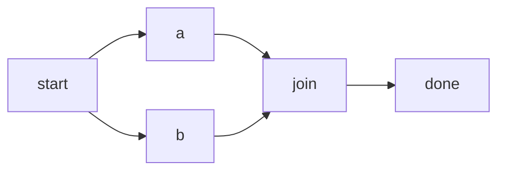

A flow is steps joined by connections. A run follows the connections from the start that fired. This page explains how a run moves, and what it does when something goes wrong. To draw one, follow [Draw and deploy a flow](../../how-to/flows/draw-and-deploy-a-flow).

## The idea

A flow run remembers where it is. After each step, its state is saved: which steps are done, what each gave, and which are waiting. A worker that stops does not lose the run. The run is picked up again, and the steps that finished are not repeated.

A sweep looks over the runs that can move every 2 seconds, up to 200 at a time, so a step that waits for a time wakes up to about 2 seconds late. A pass that throws three sweeps in a row fails its run, with the reason.

## Paths

A step with several connections out starts all of them, side by side. A step is started by the first path that reaches it, and only once, unless it is a **Join**. A **Join** waits for every path into it that can still arrive. A path that a **Branch** did not take cannot arrive, so a Join does not wait for it.

A **Branch** tries its cases in order and takes the first whose expression is true. Without one it takes **Otherwise**.

## When a step fails

A step that fails takes its error path, the red dot, if it has one. The step is then marked handled and the flow goes on. A step that fails with no error path fails the run: everything still active is canceled and the run ends as **Failed**.

Steps have no retry setting. A script has its own retries, and its default is none. A failed run can be run again from its failed step; see [Retry or cancel runs](../../how-to/flows/retry-or-cancel-runs).

An **Approval** that is rejected, or that times out, fails like any step: it takes its error path, or fails the flow. A **For each** can keep going when an item fails; the failed item then gives `error.message` in the list.

## Waiting

A **Wait** and an **Approval** hold no worker. A run waiting for a person is listed in [Approvals](../../reference/screens/operate/approvals). A run set to start later says "Waiting until" a time, and its state is "Waiting for a time".

## Versions

A run is pinned to the version of the flow that was deployed when it started, and so are the sub-flows it starts. Deploying a new version does not change a run that is going. A retry may be sent to another version: the console says what will run again before it does.

## Output and large values

What a flow gives back is what its last steps gave, by name. A last step that has only an error path after it still counts. A value over 256 KB is kept apart and shown in an expression as a note that it is stored; read it in a script.

## Limits

| Limit | Value |
| --- | --- |
| Steps in a flow | 200 |
| Connections | 1000 |
| Loops | None allowed |
| Items in a **For each** | 1000 |
| Flows started by flows | 10 deep |
| Events started by events | 10 deep |
| A **Wait** | 1 second to 30 days |
| An **Answer the request** body | 256 K characters |
| Script runs at once in a workspace | 10 unless changed, from 1 to 1000. It limits script runs only, not flow runs |

An expression has its own limits: see [Expressions in a flow](../../reference/flows/expressions). A deploy that has a schedule and its flow applies them in kind order, so the schedule may be at an earlier path than the flow.

When a run is canceled it publishes `platform/run-finished` with the status `cancelled`.

## Related

- [Flow steps](../../reference/flows/steps), [Ways a flow starts](../../reference/flows/starts)
- [Platform events](../../../develop/reference/platform-events)
