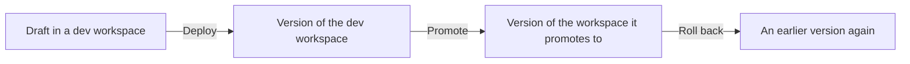

A tenant makes its changes in a dev workspace and sends them to production in separate steps. This page explains the steps, what travels in each, and what Git adds. To do them, follow [Deploy drafts to a dev workspace](../../how-to/releases/deploy-drafts) and [Promote a version](../../how-to/releases/promote-a-version).

## The idea

A change goes through four states.

- A **draft** is a change saved in a dev workspace and not yet running. Anyone who may write there sees it, and it can be set aside.
- **Deploying** drafts makes a **version** of that dev workspace. The drafts become part of what it runs, as one step that takes all of them or none.
- **Promoting** sends the version that runs in the dev workspace to the workspace it is linked to. It is deliberate, and it is a separate step from deploying.
- **Rolling back** is deploying an earlier version again.

Production is not a place you edit. The editors say so on a production resource: "Edit it in *dev workspace*".

## A version is a bundle, and a promotion sends the same one

A deploy composes the drafts with what the workspace already runs into a **bundle**, and the bundle becomes the workspace's next version. A bundle has a digest. A promotion gives the target workspace the same bundle, by its digest: nothing is rebuilt, so what ran in dev is what runs in production.

Version numbers belong to the workspace. Production's version 4 may be dev's version 9, and the list of versions says which workspaces now run a bundle with "Running in *name*", found by the digest.

A promotion sends resources. It does not send what belongs to a workspace and not to its definition:

- Data: rows and files stay where they are.
- Secrets, and the values a workspace gave to its variables.
- Bindings: which real system a connection or a data source points to in that workspace.

So a promotion refuses when what the version needs is not set up in the target: a script that reads a secret needs it set in production first. A deploy to a dev workspace is more forgiving: it goes ahead, warns "Not set up here, and the deploy still works", and a run that reaches the missing thing fails until it is set up. A promotion, and a deploy to production, refuse. See [Why a deploy or promotion is refused](../../../develop/reference/releases/refusals).

A resource that was made in the console and that no bundle carried is left alone by every deploy.

## Why production does not take edits

A production workspace has no drafts. A direct change to one of its resources is refused unless the person holds `promotion:write` and the resource was made in the console. A resource that the repository defines changes in production by a deploy only.

There is no workspace lock. Production's resources change by a deploy, a promotion, or someone who holds `promotion:write`, and not by an editor.

This is why a person who may deploy to dev may not be allowed to promote. The built-in role Developer deploys to dev workspaces and does not hold `promotion:write`. Such a person **requests** a promotion with a note, and someone who holds `promotion:write` promotes the version asked for, or declines with a reason. A new request replaces an earlier pending one for the same two workspaces.

## A rollback is a deploy

**Roll back to this version** puts an earlier version in place. It is a deploy: it deletes no version. The version you put back moves to the top of the list, which counts how often each one was deployed. Runs in progress finish on the version they started with, and new runs use the version now in place. The screen's word depends on the direction: **Roll back to this version** for an earlier version than the one running, **Deploy this version** for a later one or one that never ran in this workspace.

## What a rename does to this

A resource has a path, which people read and call it by, and a key, which stays with it. A deploy matches what it carries to what a workspace has by key. A resource found at a new path with the same key is a rename, and what it holds comes along.

A deploy that would delete a resource that holds runs, rows or access given by hand, while creating another of the same kind, looks like a rename done wrong, because the new one would be cut off from what the old one holds. It is refused as `rename_suspected` until someone says to delete it anyway, or gives the new resource the old key. A deploy of drafts does not stop for this, because the drafts are what the person chose.

## What Git adds

A tenant can connect one Git repository. Then:

- A dev workspace **follows a branch**. A **push** commits what is deployed in the workspace to the branch, as resource files, in one commit. A **pull** deploys what developers changed on the branch. A resource changed on both sides is a conflict that a person settles file by file. Nothing is chosen for you.
- A **production workspace follows no branch**, because it changes by promotion. After each promotion, what it runs is committed to a **release branch**, `<release branch>/<workspace slug>`, as a mirror. If that commit fails the promotion stands, and **Commit to the release branch again** repeats it.
- Sync moves the resources the console owns, as files. It never builds code. A resource written in the repository's TypeScript changes in a workspace by `volvel deploy` or a promotion, not by a pull. A draft over such a resource **takes it over**: deployed, it becomes a resource the console owns, and Git sync then carries it. A deploy from the repository that still defines it takes it back.
- A **push** and a **deploy** are different acts. A push writes what is already deployed to Git. It does not deploy. A pull deploys. That is why a pull needs `deployment:write` and `code:write`, and a push needs `git:write`.
- `volvel.yaml` at the repository's root says where the resource files are. Its `resources` folder wins over the **Folder** field of the Repository page.

Volvel does not receive webhooks from the repository and does not sync on a schedule. A push, a pull and the release commit happen when someone asks, or after a promotion.

## How it fits

| You want to | Do | Reference |
| --- | --- | --- |
| See what is waiting to go | Review the drafts | [Deploy and Versions](../../reference/screens/operate/releases) |
| Keep a workspace and a branch the same | Push and pull | [Git sync](../../reference/screens/operate/git-sync) |
| Set the repository | Connect it | [Repository](../../../administer/reference/screens/repository) |
| Make another place to try changes | Create or clone a workspace | [Workspaces](../../../administer/reference/screens/workspaces) |
