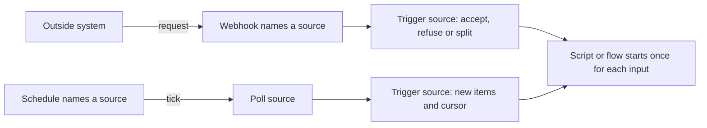

An extension is code a workspace writes for something Volvel cannot know in advance: how to reach one particular outside system, or how to turn one particular sender's requests into runs. It is written once, deployed with the rest of the workspace, and then named by the resources that use it.

There are two kinds: the **connector** and the **trigger source**. The console lists both on its **Extensions** screen. They are the only kinds of extension that a tenant writes as code of their own, apart from a [script that is also a flow step](../../how-to/extensions/flow-steps-from-code).

## The idea

Volvel keeps what is the same everywhere and lets a workspace supply what is not.

A **connection** is a connector plus settings plus a secret. The connector is code. The settings and the secret are set for each workspace on the **Connections** screen, so dev and production can point at different places while running the same code. The code stays in version control; the address and the key do not.

A **connector** turns a connection's settings and secret into the client that a script uses. `defineConnector` takes a JSON Schema for the settings, which is what the **Connections** screen draws its form from, a `create` function that builds the client, and an optional `test` function that the connection's **Test** button runs. A script then asks for the client by the connection's path and gets what `create` built. A connector does not run on its own: a script or a trigger source that uses the connection runs it.

A **trigger source** stands between the outside and what a trigger starts. A webhook or a schedule that names a trigger source hands it each request or each tick, and what the source answers decides what starts. It has two modes:

- A **webhook** source is handed each request, with its method, headers, query, parsed body and raw body. It answers that nothing starts and why, that one run starts with an input, or that one run starts for each of several inputs, up to 100. This is where a signature in a sender's own format is checked, or one request is split into many.
- A **poll** source is handed the cursor it gave last time and when the tick was due. It answers with the items that are new and the cursor to continue from. This is where a system that must be asked what is new is asked.

A trigger source runs on a worker like a script. It reads only the connections, secrets and variables that it lists. It cannot read tables or publish events. Nobody starts one by hand: it runs when a request arrives or a schedule ticks.

## What needs no extension

Most workspaces never write one.

| You want | What to use |
| --- | --- |
| Call an HTTP API with an address and a key, a header or HTTP Basic | The built-in `http` connection. |
| Send mail | The built-in `smtp` connection, with `tls`, `starttls` or no encryption. |
| Reach an account at a provider such as Google or Microsoft | The built-in `oauth2` connection, authorized once. An OAuth 2.0 connection cannot be a member of a connection group. |
| Accept a webhook that signs its body with HMAC SHA-256 or SHA-1 | The webhook's own signature check, set on the webhook. A request that fails it is refused with 401. |
| Start a run on a clock | A schedule, with no source. |
| Do something in a flow that has no step | A [script](../../../console/reference/screens/build/scripts), or a script given a step name. |

Write a connector when an outside system wants more than an address and a key. Write a trigger source when a sender signs its requests in a way of its own, sends many events in one request, or has to be asked what is new.

## How it fits

An extension is a resource like a script. It is written in the console in a dev workspace, or in the tenant's repository with `defineConnector` and `defineTriggerSource`. Either way it is deployed as part of a version.

Code written in the console may import `@volvel/sdk` and `node:` modules and nothing else, and may be 256 KiB. Code in the repository may use packages and share files. An extension from the repository is read-only in the console, and one made in the console at the same path replaces it on the next deploy.

A trigger source's answer is passed on whole or not at all. If it gives more than 100 inputs, or a poll's items are not a list, the source's run fails, nothing starts and the cursor stays. One item that does not fit what it starts is refused alone: the others start and the cursor moves. Every run it starts is keyed to the source's run and its position, so passing on the same answer twice starts nothing twice.

## What is not there

- A widget a developer writes for their own users is not an extension a tenant can ship. Volvel's widgets are built into the product. See [Write a widget](../../how-to/writing-a-widget).
- A trigger source cannot start a run itself. It answers, and Volvel starts the runs.
- There is no test pane for a connector or a trigger source in the console. They are tried by deploying them and using them.

## Related

- [Write a connector or a trigger source in the console](../../../console/how-to/extensions/write-an-extension)
- [Extensions](../../../console/reference/screens/build/extensions) and [the extension editor](../../../console/reference/screens/build/extension-editor)
- [Flow steps from code](../../how-to/extensions/flow-steps-from-code)
