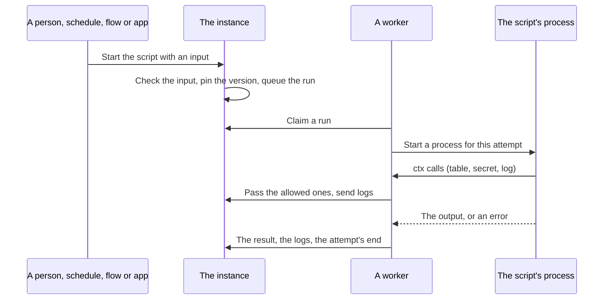

A script is code that a worker runs for a workspace. The workspace holds the definition, the instance holds the queue, and a worker, a process that may be on another machine, takes a run from the queue and runs it. This page follows one run from the request to the result, then says what a script cannot do, and what is left to the script.

## The idea

Volvel does not run a script where it is asked for. A request to run only records what is wanted: it checks the input, pins the run to a version, and puts it in a queue. The worker is the one who claims it. That separation is what lets scripts run inside a client's network, on a machine with more memory, or not at all while the instance is up, and it is why a run can wait.

## From the request to the queue

When a run is asked for, the instance checks the input against the script's input schema and refuses a request that does not match it: "The input does not match the script's schema." The run is then **pinned to a bundle**, the version deployed at that moment. A deploy while the run waits does not change what it runs. This is also why a run again offers a choice: on the version it ran, or on the version deployed now.

A run set for later is queued with a time and waits for it. A priority from -100 to 100 orders runs that wait for a worker.

A test run from the editor is the same, with the draft built into a bundle of its own, never deployed. Those bundles and their runs are deleted after seven days.

## A process for each attempt

A worker claims a run and starts a **new process for each attempt**. It runs with only `PATH`, `TZ`, `LANG`, `TMPDIR` and `NODE_EXTRA_CA_CERTS` as its environment and never holds the worker's own credential. When the script asks `ctx` for a table, a secret or a connection, the call goes to the worker, which passes it on to the instance only if it is one of the run's declared things. A script that asks for something it did not declare fails.

Volvel does not put each script in a container. A managed worker has a user of its own on the host, and a process per attempt is the unit that is watched, limited and ended. What a script can reach on the network is the worker host's firewall: addresses that are private, loopback or link-local are closed unless `WORKER_EGRESS_ALLOW` opens them. A script uses plain `fetch` and is not held to the instance's own `EGRESS_ALLOW`, which is for the instance's calls. See the [settings reference](../../../self-host/reference/settings).

## What a run is held to

| Limit | What happens |
| --- | --- |
| Time | After the script's limit (60 seconds for a console script, 300 for a script in code, up to 3600) the run is told to stop through `ctx.signal`, given 3 seconds, and then killed. It fails with "The run took longer than its limit of N seconds." |
| Memory | The script's heap is capped at its `memoryMb`. The whole process may hold that and 64 MB beside it, checked every half second. Past it: "The script ran out of memory (N MB)." A machine that is itself short of memory ends a script with "The script was stopped: the machine ran low on memory." |
| Output | At most 10 MB. A larger output fails the run with "The output is larger than 10 MB (it is N MB). The script's work was done and is not repeated." and it is not tried again. |
| Logs | A line's message is cut at 8,000 characters, and its fields over 32 KB are replaced by a note. A worker keeps 5,000 lines while the instance cannot be reached and says "N log lines could not be saved." when it gave up. |
| Silence | A worker that says nothing for 30 seconds is taken to be lost. The run goes back to the queue with "The worker stopped responding. The run is being retried." |
| Cancel | A running script hears of a cancel at its next heartbeat, and then the same stop as a timeout. |

An input or output over 256 KB is kept in file storage, not in the run's record.

## Retries and at-least-once

A failed attempt is tried again after the script's wait, up to its `retries.limit`, and the wait grows with each try when `backoff` is on. A retry runs the whole script again. A run is delivered **at least once**, and with a limit of 0 it can still run twice, for example when a worker is lost after the script did its work but before it said so. A script that sends a message or charges a card must be safe to run twice. `ctx.run.idempotencyKey` is the same across the attempts of a run for this reason. A run whose output was too large is not tried again; one whose process crashed is.

When the last attempt fails, the script's `onFailure` runs: its handler script and its notification, in place of the workspace's default. The handler reads the script as deployed now, not as the failed run had it.

## What is masked

A value that looks secret is shown as `[redacted]` wherever a run is shown: by the key's name (`password`, `token`, `api_key` and their suffixes) or by the schema (`writeOnly`, `format: "password"`, `x-secret`). The log lines, errors and failure alerts of a run are also masked by value, whatever key the value sits under: the secrets the run was given and credentials, in plain, URL-encoded, JSON-escaped and base64 forms. A secret shorter than 4 characters is masked only as a whole word. Masking changes what is shown. What is stored and what the script receives are not changed, and a secret rotated since a line was stored cannot be found by value.

Because a shown input can be masked, running again with a masked input asks you to enter the masked values again.

## What a finished run says

A run that ends publishes `platform/run-finished` with its status for succeeded, failed and canceled, besides the older `platform/run-succeeded` and `platform/run-failed`. A script's run page lists the events the script published and what its failure alert did.

## What the platform does not check

- That the script is safe to run twice.
- That it reads only the rows it should: without `.as(...)` a script reaches every row of a table it declared.
- Types, in a script written in the console. It is built, not type checked.
- What a script does with the files of the workspace: a script may read a file by its ID.

## How it fits

- [The script context](../../reference/scripts/script-context) says what `ctx` gives a script.
- [Scripts in code](../../reference/scripts/define-script) lists the limits as options.
- [Run a script now or later](../../../console/how-to/scripts/run-a-script) is how to start one.
- [Runs](../../../console/reference/screens/operate/runs) is where a run is read.
