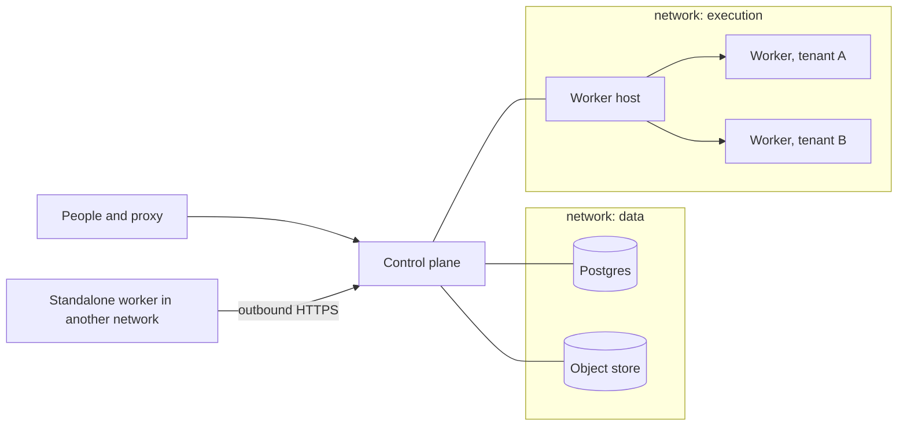

An instance is one image run as up to three programs, plus a Postgres database and an S3-compatible object store. The same image runs a shared instance, a dedicated one and an on-premises site. What differs is the settings you give it.

## The idea

You keep four things, and only these hold state:

| Part | What it does | State it keeps |
| --- | --- | --- |
| Control plane | The API, the console, the scheduler, the queue and the flow engine. | None on disk. It needs no persistent volume. |
| Postgres | The instance's records, the queue and every tenant's tables. | Everything except files. |
| An S3-compatible object store | Bundles, uploaded files, large payloads and archived audit months. | The files. |
| Workers | Run a tenant's scripts. The instance starts them, or you run your own. | None. A worker fetches what it needs again after a restart. |

To back up an instance, back up Postgres and the object store, and keep every master key a backup was sealed with. See [Back up an instance](../../how-to/running/back-up-an-instance).

The control plane never runs a tenant's code. A script runs on a worker, in a process of its own. See [Workers, users and what a script can reach](managed-workers-and-isolation).

## One image, three programs

The image `volvel/volvel` holds three entry points. They differ only in what they start.

| Program | Started as | Used for |
| --- | --- | --- |
| The control plane | `volvel-start dist/main.js` (the image's default command), port 8080, user `node` | Every instance. |
| The worker host | `volvel-worker-host` | An instance that starts workers for tenants (`MANAGED_WORKERS=host`, the Compose default). |
| A standalone worker | `node node_modules/@volvel/worker/dist/bin.js` | A worker you run in another network. |

`volvel-start` runs the control plane on `node-cp`, a copy of Node that holds `CAP_SETUID` and `CAP_SETGID`. Where the container may not switch users, it runs it on plain Node instead.

The image sets `CONSOLE_DIR=/app/console` and `SCREENS_DIR=/app/screens`, the folders of the console and of the app that draws interfaces. An instance run from source finds them after `pnpm build`.

## Two networks

The Compose file puts the parts on two networks:

- `data` holds the database and the object store. Only the control plane joins it.
- `execution` holds the control plane and the worker host.

A tenant's script can reach the control plane and the internet. It cannot reach the database or the object store, because the worker host is not on `data`. See [What an instance reaches](egress-and-offline) for what the host's firewall refuses on top of that.

A standalone worker makes outbound HTTPS requests to the instance and nothing needs to reach it. See [Run a standalone worker](../../how-to/running/run-a-standalone-worker).

## What the control plane does while it runs

Besides answering requests, each replica runs a background loop. Each step has its own timer and its own "still going" flag, ticking every 2 seconds, so a step that waits (a data source that does not answer) delays only itself and is never started twice at once. A step that has run for more than 60 seconds is logged as late.

The steps: schedules, lost runs, dead runs, tasks, flows, expired sign-ins, health of data sources, retention, the master key and managed workers.

Every replica runs the loop. Work that must happen once, such as a retention pass, is taken by one replica at a time.

## How it starts

- The command word is read first. `--help` and a word that is not a command stop here, before anything is read.
- The settings are read. Every problem is listed together, and the process exits with 1. `check-config` stops here.
- The database is migrated. `migrate` stops here. It then checks whether the database takes writes.
- The app is built. `rekey` and `recover-operator` run here and exit.
- The bucket is checked, and made if the store says it is not there. Then, when the database takes writes, the first operator is created if the instance has no members, a rotation is finished, and the instance starts listening.
- Only then does the loop start, and the control plane starts rechecking, every 10 seconds, whether the database takes writes.

A database that takes no writes does not stop the instance. It listens and serves what reads can. See [Run on a read-only database](../../how-to/running/run-on-a-read-only-database).

Related: [the commands](../../reference/running/commands), [settings](../../reference/settings), [requirements](../../reference/running/requirements).
