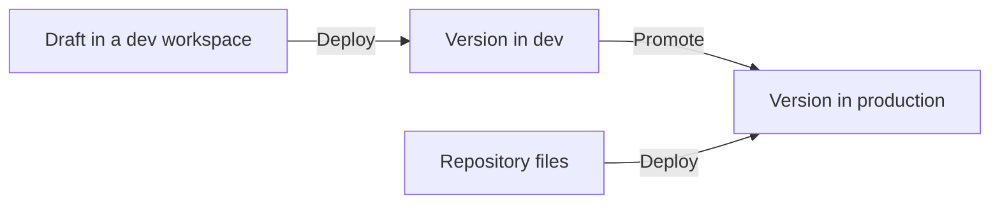

A tenant keeps its work in workspaces, and every workspace is one of two kinds: dev or production. The kind is chosen when the workspace is made and can never be changed. The console marks production on every screen: a **Production** tag in the header and an amber rule under it. A dev workspace has a **Dev** tag.

## The idea

A dev workspace is where things are made and tried. You change scripts, flows, apps, queries and the rest in the console, and each change is a :term[draft]{id=draft}: saved, and not yet running. A production workspace is what the business runs on. It does not take drafts, and its editors in the console are read only. Its resources change in two ways: a :term[deploy]{id=deploy} of a repository's files, or a :term[promotion]{id=promotion} from a dev workspace.

The reason is that production should never be a surprise. A change reaches it as a whole, as one :term[bundle]{id=bundle}, which can be read first, refused if something it needs is missing, and rolled back by going to an earlier version.

## What a deploy and a promotion are

Deploying in a dev workspace turns its drafts, and what is in the repository, into a numbered :term[version]{id=volvel-version} that runs there. The screen is called **Deploy** in a dev workspace and **Versions** in a production workspace; its buttons are **Deploy this version** and **Roll back to this version**.

A dev workspace can be linked to the workspace it promotes to. The link is either production or another dev workspace, such as a QA workspace. Only a dev workspace can link, a link must lead somewhere and end, and the console shows it as "promotes to {name}" in the header and as the last step of the **Deploy path**. Promoting sends the same bundle to the linked workspace, and the overview says whether the two run the same bundle or "a different bundle. Promote to bring it up to date."

Version numbers belong to a workspace. The same bundle can be version 9 in a dev workspace and version 4 in production; what the two share is the bundle itself.

## What travels and what stays

| Travels in a version | Stays in the workspace |
| --- | --- |
| Scripts, flows, apps, queries, table definitions and the other resources of the bundle. | Table rows and files: they are the data this workspace keeps. |
| The names of the connections, secrets, variables and data sources a script uses. | What those names are set up as here: a connection's settings, a secret's value, a variable's value. Each workspace has its own. |

A deploy to a production workspace, and any promotion, is refused when the bundle uses something that is not set up in that workspace: "The workspace is missing something this bundle needs. Set up each one, then deploy again." (or "promote again"). A deploy to a dev workspace goes ahead and warns, and a run that reaches the missing thing fails with the same words. This is why the overview of a new workspace says "{n} connections are not set up here".

A trigger does not start work in a dev workspace until you resume it: a new dev workspace starts with its triggers paused, so that a schedule you try there does not run beside production's. Runs you start by hand still work.

## What is left to others

Volvel has no lock on a workspace. Production changes by deploy and by promotion because the editors there are read only and a direct write is refused: "Resources are edited in a dev workspace and reach production by promotion." The exception is a person who holds `promotion:write`, who may write a console-made resource there directly. A resource kept in a repository is changed there, and arrives by a deploy, for everyone.

## How it fits

## Related

- [Concepts](../concepts)
- [Releases](../../../console/reference/screens/operate/releases): the **Deploy** and **Versions** screen.
- [Workspace overview](../../../console/reference/screens/home/workspace-overview)
