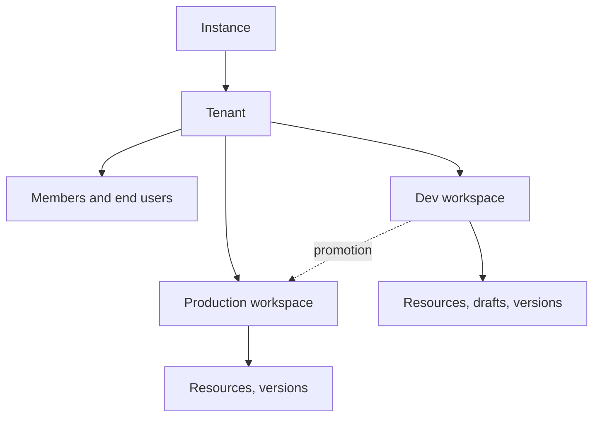

These are the words every screen of Volvel uses, in the order they fit inside each other.

## The instance and its people

An :term[instance]{id=volvel-instance} is one running copy of Volvel. It has its own database and holds any number of tenants. The people who run it are its :term[operators]{id=volvel-operator}. An operator makes tenants, sees the screens under **Instance**, and can pause every trigger on the instance. An operator does not see inside a tenant unless they are one of its members or open an access grant, which needs a reason, ends by itself and is visible to the tenant's admins.

A :term[tenant]{id=tenant} is one team's space on the instance. Everything a tenant has is kept apart from every other tenant's. A tenant has :term[members]{id=member}, who sign in to the console, and :term[end users]{id=end-user}, who use its apps and do not.

Nobody makes their own account. An administrator adds each member, and an operator makes each tenant. There is no self sign-up, no multi-factor sign-in and no passkey. See [Sign in](../how-to/basics/sign-in).

## Workspaces

A tenant's work lives in :term[workspaces]{id=workspace}. A :term[dev workspace]{id=dev-workspace} is where things are made and tried. The :term[production workspace]{id=production-workspace} is what the business runs on, and the console shows it as such on every screen. The two are not copies of each other's data: see [Dev and production workspaces](basics/dev-and-production).

## Resources and how a change takes effect

Everything in a workspace is a :term[resource]{id=resource}: scripts, flows, tables, connections, apps and more are managed the same way. Each has a path, such as `clinics/send-reminders`.

A change saved in the console is a :term[draft]{id=draft}. Nothing a draft says is live until a :term[deploy]{id=deploy}, which applies a set of changes together as a :term[bundle]{id=bundle}. The workspace then runs a numbered :term[version]{id=volvel-version}. The workspace a dev workspace is linked to receives the same bundle by :term[promotion]{id=promotion}. A table's rows are different: a row is data, and it changes at once when you save it.

## Work that runs

A :term[run]{id=run} is one execution of a script or a flow. A :term[trigger]{id=volvel-trigger} is what starts a run on its own: a schedule, a webhook, a form, an event or a poll. A flow step can be an :term[approval]{id=volvel-approval}, which holds the flow until a person decides.

## Who may do what

What a person may do is decided by roles. A role is a set of permissions, written like `flow:write`. A :term[binding]{id=binding} gives a role to a member, a group or a service account, at the tenant, at a workspace or on one resource. A permission given at a workspace counts there alone. A change to who holds what is an :term[access change]{id=volvel-access-change}. When you cannot do something, the screen says which permission it needs; see [What you may do](basics/what-you-may-do).

## How it fits

## Related

- [Finding your way](../reference/basics/finding-your-way): the rail, the header and the switchers.
- [Dev and production workspaces](basics/dev-and-production)
- [What you may do](basics/what-you-may-do)
